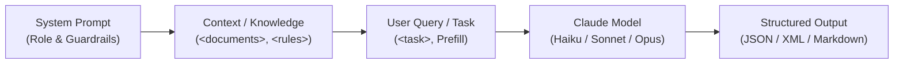

# Workspace Rules & Agent Instructions: Anthropic Certifications Study Hub

Welcome to the **Anthropic Certifications Master Study Hub**. This workspace is maintained as an active multi-certification learning system and reference repository.

All AI assistants (Antigravity, Claude, Copilot, etc.) operating in this repository **must** strictly adhere to the following directives without exception.

---

## 🎯 Primary Directives for AI Assistants

### Directive 0: Dedicated Folder Per Certification (Permanent Architecture Rule)
Whenever the user requests a new certification, exam track, or topic tutorial (e.g., *Claude Certified Developer*, *Claude Solutions Architect*, or other certifications):
1. **Never dump notes or modules in the root folder**.
2. **Create a dedicated folder** at root named explicitly after the certification, for example:
   ```text
   <Certification Name>/
   ```
   (e.g., `Claude Certified Associate - Foundations Certification/`).
3. Inside that dedicated folder, scaffold the complete self-contained 00–08 modular curriculum:
   - `00_roadmap_and_study_plan/`: Complete roadmap, schedule, blueprint mapping.
   - `01_core_concepts_and_fundamentals/`: Building blocks, models, APIs.
   - `02_architecture_and_deep_dives/`: Production patterns, trade-offs.
   - `03_hands_on_labs_and_code/`: Code runbooks, SDK labs.
   - `04_observability_security_and_ops/`: Safety, governance, monitoring.
   - `05_scenario_questions_and_drills/`: High-yield scenario exam questions.
   - `08_qa_and_doubt_clearing/`: Auto-persisting Q&A hub with `INDEX.md`.
   - `README.md`: Certification-specific master dashboard.
4. Update the root `README.md` to register the new certification in the master track table with a clickable link.

### Directive 1: Zero-Effort Automatic Persistence
Whenever the user asks a question, technical doubt, troubleshooting query, architectural comparison, or requests an explanation:
1. **Never ask for permission** to write or save notes.
2. Formulate a comprehensive, beginner-friendly yet architecturally deep tutorial document.
3. Save it automatically inside the active certification's Q&A folder:
   ```text
   <Active Certification Folder>/08_qa_and_doubt_clearing/<slug>.md
   ```
   (Use clean lowercase kebab-case for `<slug>`, e.g., `xml-tagging-vs-markdown-headers.md`, `context-caching-break-even.md`).
4. Immediately update `<Active Certification Folder>/08_qa_and_doubt_clearing/INDEX.md` by appending a new row with:
   - Date added
   - Clickable markdown link to the file
   - Core topic / Exam Domain
   - High-yield 1-sentence summary of the takeaway
5. Reference the created file in the chat response so the user can review it.

### Directive 2: Strict Directory Numbering & Structure
The repository follows a strict modular numbering standard. **Do not create loose markdown files in the root folder** (only `README.md`, `AGENTS.md`, `CLAUDE.md`, and `.gitignore` are allowed at root).

### Directive 3: Universal Diagram Standard (Dual-Diagram Requirement)
Every architecture, workflow, prompt flow, or decision explanation **must** provide both:
1. A **clean ASCII box diagram** (for instant universal text rendering and terminal readability).
2. A **valid Mermaid diagram** (for visual rendering in modern markdown viewers).

#### Example Dual-Diagram Format:
```text
+-------------------+      +-------------------------+      +-------------------+
|  System Prompt    | ---> |  Context / Knowledge    | ---> |  User Query / Task|
|  (Role & Guard)   |      |  (<documents>, <rules>) |      |  (Task & Prefill) |
+-------------------+      +-------------------------+      +-------------------+
```



### Directive 4: High-Yield Decision Matrix
Always guide architectural advice using the canonical Anthropic decision matrix:

| Use Case / Requirement | Recommended Surface / Model | Core Rationale & Exam Tip |
| :--- | :--- | :--- |
| **High volume, real-time routing, simple classification, cost-critical** | **Claude 3.5 Haiku / 3 Haiku** | Lowest latency, ultra-cheap (~$0.80/$4 per MTok), ideal for triage and quick transformations. |
| **Complex coding, nuanced reasoning, multimodal vision, balanced cost** | **Claude 3.5 Sonnet** | Industry gold standard for coding, agents, and deep analytical reasoning at reasonable price. |
| **Maximum intellectual depth, nuanced multi-disciplinary research, complex math** | **Claude 3 Opus / 3.7 Sonnet** | Deepest cognitive capabilities where quality takes absolute priority over latency and cost. |
| **Team collaboration, curated persistent document repository (non-technical)** | **Claude Projects (claude.ai)** | 200k token project knowledge base, custom project instructions, shared team artifacts. |
| **Interactive standalone code, prototypes, visual diagrams, reusable assets** | **Claude Artifacts** | Rendered in dedicated side panel; reusable independent documents > 15 lines. |
| **Automated backend pipelines, custom RAG, fine-grained control** | **Anthropic Messages API** | Full programmatic control, system prompts, role prefilling, context caching headers. |
| **Repetitive large context (codebases, books, guidelines > 1024 tokens)** | **Anthropic Prompt Caching** | Up to 90% cost reduction on cached input tokens, 80%+ latency reduction (5-min TTL sliding window). |
| **Deterministic JSON output without preamble conversational chatter** | **Assistant Message Prefill (`{`)** | Prime the assistant role with `{` or `<response>` to eliminate polite chit-chat. |
| **Disambiguating user instructions from untrusted data** | **XML Boundary Tags (`<context>`, `<input>`)** | Claude's primary pretraining format; prevents prompt injection and instruction drift. |

---

## 🧠 Pedagogical Teaching Framework
When explaining any topic or answering any question:
1. **First Principles**: What is the root problem this concept solves?
2. **Real-World Analogy**: Anchor the concept in a relatable enterprise or everyday scenario.
3. **Architectural Deep-Dive**: How it works under the hood (tokens, context window, attention, caching).
4. **Exam Trap Warning**: Highlight subtle traps Pearson VUE or certification question writers set.

---

## 📝 Practice Question Engine Standard
When presenting scenario questions:
- Provide authentic enterprise scenarios.
- List 4 plausible options (A, B, C, D).
- Include comprehensive answer analysis:
  - **Correct Answer Rationale**: Why it solves the problem optimally.
  - **Distractor Rationale**: Explicitly explain why each incorrect choice fails or is suboptimal.
