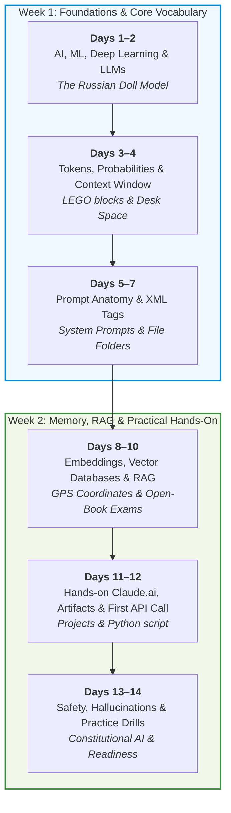

# 00. Beginner Roadmap & 14-Day Learning Path

Welcome to the beginner road map! If you are starting with zero technical knowledge, this curriculum is mapped into a stress-free **14-day journey** (averaging 30–45 minutes per day). 

By the end of these two weeks, concepts like **Tokens**, **Embeddings**, **Vector Databases**, **RAG**, and **Prompt Architecture** will feel intuitive and natural, setting you up to tackle the [Claude Certified Associate (CCAO-F)](../../Claude%20Certified%20Associate%20-%20Foundations%20Certification/README.md) with complete confidence.

---

## 🗺️ The 14-Day Learning Journey

```text
WEEK 1: MENTAL MODELS & CORE MECHANICS
+---------------------+     +----------------------+     +---------------------+
| Days 1-2: AI/ML/LLM | --> | Days 3-4: Tokens &   | --> | Days 5-7: Prompts & |
| What are models?    |     | Context Windows      |     | XML Tagging         |
+---------------------+     +----------------------+     +---------------------+
                                                                    |
WEEK 2: DATA, MEMORY & ADVANCED ARCHITECTURES                       v
+---------------------+     +----------------------+     +---------------------+
| Days 13-14: Safety  | <-- | Days 11-12: Claude   | <-- | Days 8-10: Vectors, |
| & Certification Prep|     | Projects & First Code|     | Embeddings & RAG    |
+---------------------+     +----------------------+     +---------------------+
```



---

## 📅 Daily Step-by-Step Breakdown

### Phase 1: Unlocking the AI Mystery (Days 1–4)
* **Day 1: Demystifying AI, ML, DL, and LLMs**
  - Read: [01_core_concepts_and_fundamentals/README.md](../01_core_concepts_and_fundamentals/README.md#1-the-ai-russian-nesting-doll)
  - Analogy: The Russian Nesting Doll & The Self-Driving Car.
  - Key takeaway: Why an LLM is not a conscious thinker, but the world's greatest autocomplete pattern matcher.
* **Day 2: The Training Lifecycle: How Claude Learned to Speak**
  - Read: [01_core_concepts_and_fundamentals/README.md](../01_core_concepts_and_fundamentals/README.md#2-the-education-of-an-ai-pre-training-vs-fine-tuning)
  - Analogy: High School diploma $\to$ Specialized Internship $\to$ Ethics & Workplace Etiquette.
  - Key concepts: Pre-training, Fine-Tuning, RLHF, and Constitutional AI.
* **Day 3: What on Earth is a Token?**
  - Read: [01_core_concepts_and_fundamentals/README.md](../01_core_concepts_and_fundamentals/README.md#3-tokens-the-lego-bricks-of-language)
  - Read Q&A: [002-tokens-vs-words-and-context-window.md](../08_qa_and_doubt_clearing/002-tokens-vs-words-and-context-window.md)
  - Analogy: LEGO bricks and puzzle pieces (~0.75 words per token).
  - Practice: Why counting words gives the wrong pricing estimate.
* **Day 4: The Context Window: Short-Term Desk Space**
  - Read: [01_core_concepts_and_fundamentals/README.md](../01_core_concepts_and_fundamentals/README.md#4-the-context-window-desk-space-vs-hard-drive)
  - Analogy: The physical executive desk. Why models forget when papers fall off the edge.
  - Claude's superpower: The 200,000-token super-desk (300 pages of text at once).

---

### Phase 2: Talking to AI Effectively (Days 5–7)
* **Day 5: Anatomy of a Great Prompt**
  - Read: [01_core_concepts_and_fundamentals/README.md](../01_core_concepts_and_fundamentals/README.md#5-anatomy-of-an-enterprise-claude-prompt)
  - Analogy: The Employee Job Description vs Daily Work Ticket.
  - Concepts: System Prompts vs User Prompts vs Assistant Prefilling.
* **Day 6: XML Tagging for Humans**
  - Read: [01_core_concepts_and_fundamentals/README.md](../01_core_concepts_and_fundamentals/README.md#6-xml-tags-color-coded-folders-for-claudes-brain)
  - Analogy: Organizing messy paperwork with colored sticky notes and Manila folders (`<context>`, `<instructions>`, `<rules>`).
* **Day 7: Controlling Creativity: Temperature and Determinism**
  - Read: [02_architecture_and_deep_dives/README.md](../02_architecture_and_deep_dives/README.md#4-temperature-the-spice-dial-of-creativity)
  - Analogy: The strict Michelin Chef (Temp 0.0) vs The Jazz Improviser (Temp 1.0).

---

### Phase 3: Memory, Vectors & Search (Days 8–10)
* **Day 8: Embeddings: The GPS Coordinate System of Meaning**
  - Read: [02_architecture_and_deep_dives/README.md](../02_architecture_and_deep_dives/README.md#1-embeddings-gps-coordinates-for-human-ideas)
  - Analogy: Google Maps for words and paragraphs. Why "puppy" is 2 meters away from "dog".
* **Day 9: Vector Databases Demystified**
  - Read: [02_architecture_and_deep_dives/README.md](../02_architecture_and_deep_dives/README.md#2-vector-databases-the-vibe-based-library)
  - Read Q&A: [001-vector-databases-vs-relational-databases.md](../08_qa_and_doubt_clearing/001-vector-databases-vs-relational-databases.md)
  - Analogy: The traditional Excel spreadsheet vs the Vibe-based Spotify Playlist.
* **Day 10: RAG (Retrieval-Augmented Generation): The Open-Book Exam**
  - Read: [02_architecture_and_deep_dives/README.md](../02_architecture_and_deep_dives/README.md#3-rag-the-ultimate-open-book-exam)
  - Analogy: A student memorizing Wikipedia vs a student allowed to look up exact books on an open shelf.

---

### Phase 4: Hands-On & Next Steps (Days 11–14)
* **Day 11: Claude.ai, Artifacts & Projects in Action**
  - Complete: [03_hands_on_labs_and_code/README.md](../03_hands_on_labs_and_code/README.md#lab-1-claude-artifacts-and-projects-ui)
  - Create a Project knowledge base and generate an interactive Artifact.
* **Day 12: Your Very First API Call (No Fear Python)**
  - Complete: [03_hands_on_labs_and_code/README.md](../03_hands_on_labs_and_code/README.md#lab-2-your-first-5-line-python-api-call)
  - Run 5 lines of Python code and see the raw JSON response.
* **Day 13: Safety, Guardrails & Hallucinations**
  - Read: [04_observability_security_and_ops/README.md](../04_observability_security_and_ops/README.md)
  - Analogy: The Trojan Horse (Prompt Injection) & The Conscience (Constitutional AI).
* **Day 14: Comprehensive Beginner Drill Quiz & Graduation**
  - Complete: [05_scenario_questions_and_drills/README.md](../05_scenario_questions_and_drills/README.md)
  - Bridge to the [Claude Certified Associate - Foundations Track](../../Claude%20Certified%20Associate%20-%20Foundations%20Certification/README.md).

---

## 🏆 Readiness Checklist

- [ ] I can explain the difference between AI, Machine Learning, and LLMs to a 10-year-old.
- [ ] I understand what a token is and can estimate token counts (~75 words per 100 tokens).
- [ ] I understand why an LLM needs a context window and what happens when it gets filled.
- [ ] I can explain Embeddings as GPS coordinates and Vector Databases as semantic similarity search.
- [ ] I know why RAG is like an open-book exam and why it prevents hallucinations.
- [ ] I understand why Claude uses XML tags (`<documents>`, `<instructions>`) to keep data separate.
- [ ] I am ready to step up to the official **Claude Certified Associate** track!

