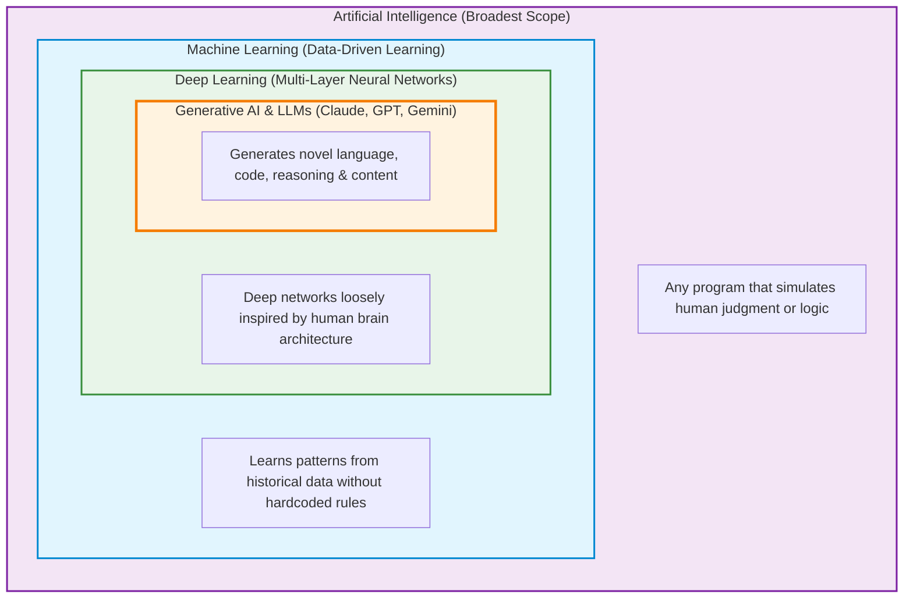
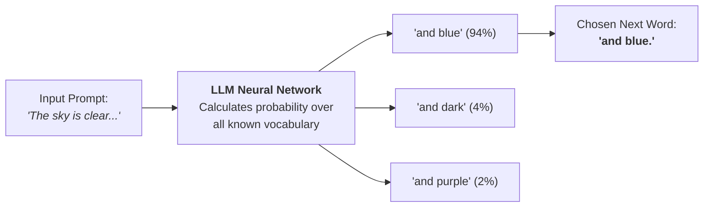
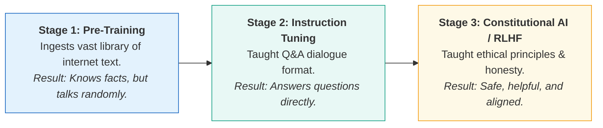
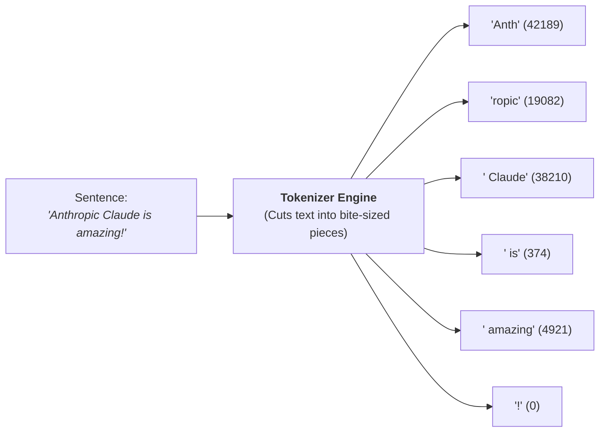
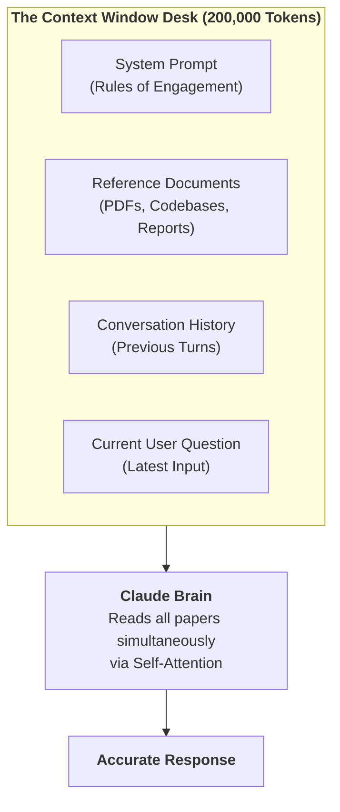
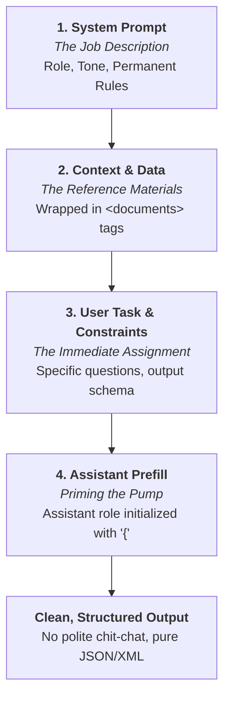
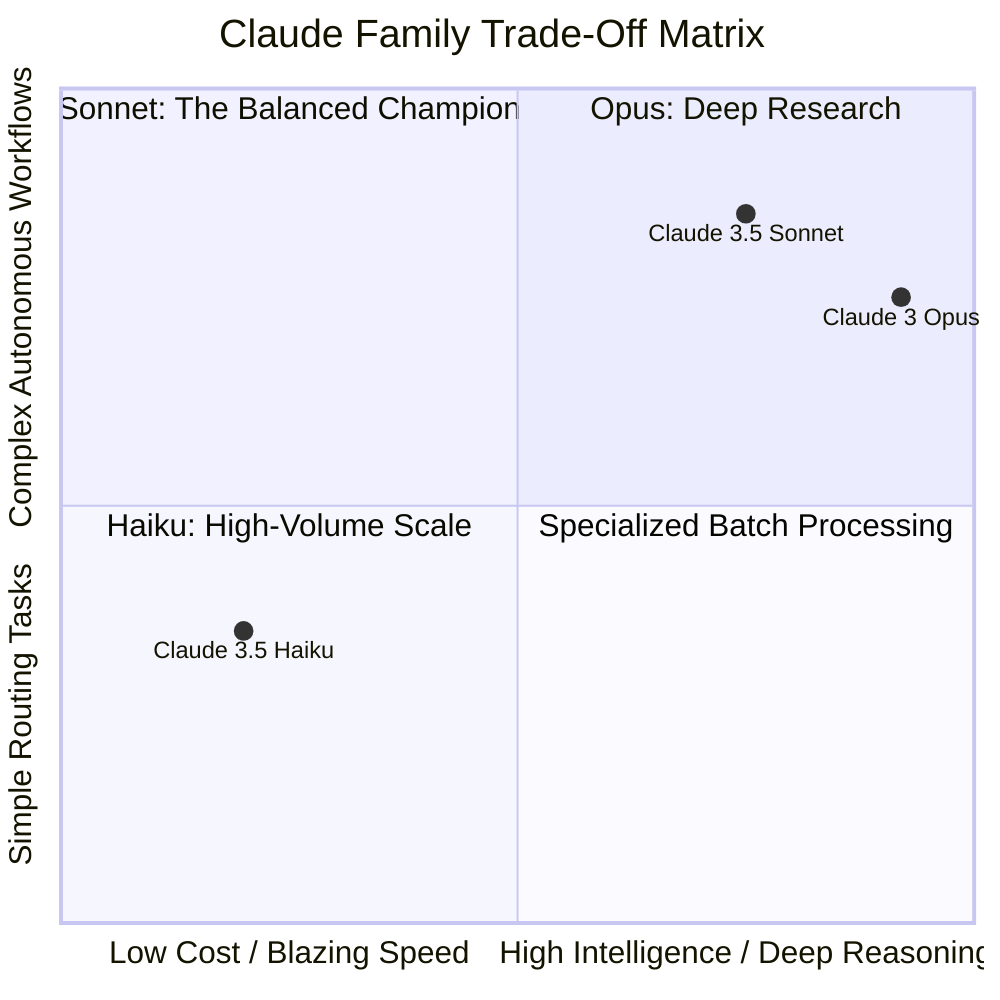

# 01. Core Concepts & AI Fundamentals: The Vocabulary Decoder

If you've ever felt overwhelmed by acronyms like **AI, ML, DL, LLM, Tokens, and Context Windows**, you are not alone! The AI industry loves complex buzzwords. 

In this module, we break down every single foundational term using **simple first principles, everyday real-world analogies, and dual visual diagrams**.

---

## 1. The AI Russian Nesting Doll

People often use "AI", "Machine Learning", and "LLM" interchangeably, but they are actually concentric layers—like a set of Russian Matryoshka nesting dolls.

```text
+---------------------------------------------------------------------------------+
| ARTIFICIAL INTELLIGENCE (AI)                                                    |
| Any machine exhibiting human-like smarts (Calculators, Chess Bots, Siri)        |
|                                                                                 |
|   +---------------------------------------------------------------------------+ |
|   | MACHINE LEARNING (ML)                                                     | |
|   | Systems that learn rules from past data (Spam filters, Credit fraud detectors) |
|   |                                                                           | |
|   |   +---------------------------------------------------------------------+ | |
|   |   | DEEP LEARNING (DL)                                                  | | |
|   |   | Multi-layered neural networks mimicking brain synapses               | | |
|   |   |                                                                     | | |
|   |   |   +---------------------------------------------------------------+ | | |
|   |   |   | GENERATIVE AI & LARGE LANGUAGE MODELS (LLMs)                  | | | |
|   |   |   | Deep neural nets that create new text, code, images (Claude)  | | | |
|   |   |   +---------------------------------------------------------------+ | | |
|   |   +---------------------------------------------------------------------+ | |
|   +---------------------------------------------------------------------------+ |
+---------------------------------------------------------------------------------+
```



### The Transportation Analogy:
1. **AI is "Vehicles"**: Anything that transports you without walking (Bicycles, Trains, Airplanes).
2. **Machine Learning is "Motorized Vehicles"**: Vehicles with engines powered by fuel (Cars, Trucks, Motorcycles).
3. **Deep Learning is "Autonomous Electric Vehicles"**: Highly complex, sensor-driven electric vehicles (Teslas, Waymo).
4. **Large Language Models (LLMs) are "Fully Autonomous Self-Flying Drones"**: The cutting-edge sub-specialty that can navigate anywhere and speak to passengers naturally.

---

## 2. What Exactly is an LLM? (The World's Greatest Autocomplete)

### First Principles:
An LLM (Large Language Model) does **not** have a conscious mind, personal feelings, or a secret soul. At its mathematical core, an LLM is a **probabilistic next-token prediction engine**.

### The Smartphone Autocomplete Analogy:
When you open your phone keyboard and type *"I am running a bit..."*, your phone suggests:
1. `late` (85% probability)
2. `slow` (10% probability)
3. `marathon` (5% probability)

```text
+-----------------------+      +---------------------------+      +------------------+
| Prompt:               | ---> | Mathematical Calculation  | ---> | Predicted Token: |
| "The sky is clear..." |      | "blue" (94%), "dark" (4%) |      | "...and blue."   |
+-----------------------+      +---------------------------+      +------------------+
```



Your smartphone keyboard has read a few thousand of your text messages. **Claude has read petabytes of human knowledge**—books, research papers, GitHub repositories, encyclopedia entries, and dialogues. Because it has seen how millions of concepts connect across human history, its "autocomplete" can write Python scripts, draft legal contracts, write poetry, and explain quantum physics!

---

## 3. The Education of an AI: How Models are Trained

How does raw computer code turn into a helpful assistant like Claude? It happens in **three sequential stages**:

```text
+---------------------+     +----------------------+     +----------------------+
| 1. PRE-TRAINING     | --> | 2. FINE-TUNING       | --> | 3. CONSTITUTIONAL AI |
| (General Reading)   |     | (Instruction Taught) |     | (Safety & Alignment) |
| "High School"       |     | "Trade School"       |     | "Ethics & Etiquette" |
+---------------------+     +----------------------+     +----------------------+
```



### The Medical Doctor Analogy:
1. **Pre-Training (Undergrad/College)**: The student reads hundreds of textbooks covering anatomy, biology, history, and language. They know a massive amount of facts, but they don't know how to treat a patient yet.
2. **Fine-Tuning (Medical School & Residency)**: The student is taught the doctor-patient dialogue format. *"When a patient says their arm hurts, you ask diagnostic questions; you don't just quote page 42 of Gray's Anatomy."*
3. **Constitutional AI & RLHF (The Hippocratic Oath & Ethics Board)**: The doctor is taught medical ethics: *"Never prescribe lethal doses, protect patient confidentiality, and do no harm."* Anthropic pioneered **Constitutional AI**, training Claude with a specific set of principles (a "constitution") to be helpful, honest, and harmless.

---

## 4. Tokens: The LEGO Bricks of Language

### First Principles:
Computers do not understand the letters "A, B, C" or the words "dog" and "cat". Computers only understand numbers ($0$ and $1$). Before Claude can process your question, it chops your text into small numeric chunks called **tokens**.

```text
Input Sentence: "Anthropic Claude is amazing!"

Token Split:    ["Anth", "ropic", " Claude", " is", " amazing", "!"]
Token IDs:      [ 42189,   19082,     38210,   374,     4921,    0 ]
```



### The LEGO Brick Analogy:
Imagine you have a pre-made LEGO set:
- Common words like `"the"`, `"and"`, or `"cat"` are single pre-molded LEGO blocks (1 token).
- Less common words like `"unbelievable"` are assembled by snapping three smaller bricks together: `["un", "believ", "able"]` (3 tokens).
- Code indentation (spaces) and emojis also count as distinct tokens!

### 💡 The Golden Rule of Thumb:
- **1 Token $\approx$ 0.75 Words** (or roughly 4 characters in English).
- **100 Tokens $\approx$ 75 English words**.
- **1,000 Tokens $\approx$ 750 words** (about 1.5 single-spaced pages).

> [!WARNING] **Exam & Practical Gotcha**:
> Why can't LLMs easily count the letters in `"strawberry"`? 
> Because Claude doesn't see the letters `s-t-r-a-w-b-e-r-r-y`. It sees two tokens: `["straw", "berry"]`! To count individual letters, you must prompt Claude: *"Break the word into individual characters separated by dashes first: s-t-r-a-w-b-e-r-r-y, then count."*

---

## 5. The Context Window: The AI's Executive Desk

### First Principles:
LLMs do not have an infinite working memory. When you send a prompt, everything the model needs to know must fit inside its active **Context Window**.

### The Physical Desk Analogy:
Imagine an executive sitting at a physical wooden desk:
- **Your Prompt & Previous Messages** are physical sheets of paper spread out on top of the desk.
- **The Context Window** is the size of the desk surface.
- The executive can read and cross-reference **any paper currently on the desk**.
- But if you place more documents than the desk can hold, older papers get pushed off the edge onto the floor. The executive literally cannot see or remember them anymore!

```text
+-------------------------------------------------------------------------------+
|                       PHYSICAL DESK (CONTEXT WINDOW)                          |
|                                                                               |
|   +-------------------+   +--------------------+   +----------------------+   |
|   |  System Prompt    |   | Reference Doc #1   |   | Chat History Msg #1  |   |
|   |  (Employee Rules) |   | (Company Policy)   |   | (User's Question)    |   |
|   +-------------------+   +--------------------+   +----------------------+   |
|                                                                               |
|   +-------------------+   +--------------------+                              |
|   | Reference Doc #2  |   | Latest User Task   |   <-- Everything on the desk |
|   | (Sales Numbers)   |   | (Draft Summary)    |       is visible to Claude!  |
|   +-------------------+   +--------------------+                              |
+-------------------------------------------------------------------------------+
   |
   | (If context exceeds limit...)
   v
[ Floor: Forgotten past messages ]
```



### Claude's Superpower: The 200,000 Token Desk
Most early AI models had tiny desks (only 4,000 to 8,000 tokens—barely 10 pages of text). 
**Anthropic's Claude features a massive 200,000-token context window standard across all models!**
- That is equivalent to **~150,000 words** or **~500 pages of text**.
- You can drop an entire corporate handbook, a financial SEC 10-K report, or a 50-file software codebase onto Claude's desk at once!

---

## 6. Anatomy of an Enterprise Prompt

Talking to an LLM effectively is like managing a brilliant, eager intern. If you say *"Make this better"*, they have no idea what "better" means. If you give them a clear folder with rules, context, and format, they deliver world-class work.

An Anthropic prompt has three distinct components:

```text
+-----------------------------------------------------------------------------+
| 1. SYSTEM PROMPT: The Employee Persona & Guardrails                         |
|    "You are a Senior Financial Analyst. Always verify math before typing."  |
+-----------------------------------------------------------------------------+
| 2. USER MESSAGE: Context + Structured Input                                 |
|    <documents> [Paste Q3 Earnings Report here] </documents>                 |
|    <instructions> Summarize the revenue variance by division. </instructions>|
+-----------------------------------------------------------------------------+
| 3. ASSISTANT PREFILL: Priming the First Word                                |
|    User sets start of reply: "{" or "<summary>"                             |
|    (Eliminates chit-chat like "Sure! I would be happy to help with that!")   |
+-----------------------------------------------------------------------------+
```



### XML Tags: Color-Coded Folders for Claude's Brain
Claude is uniquely trained to recognize XML tags like `<context>`, `<rules>`, `<examples>`, and `<task>`.
- **Analogy**: Handing someone a chaotic pile of loose papers vs placing each section inside a labeled, color-coded Manila folder.
- Claude immediately understands: *"The text inside `<context>` is reference data to read; the text inside `<instructions>` is the command to execute."*
- This completely prevents **Prompt Injection** (where an attacker tries to trick the AI inside an untrusted document).

---

## 7. The Claude Family: Haiku, Sonnet, and Opus

Anthropic provides three models designed for different enterprise trade-offs:

```text
+--------------------------------------------------------------------------------+
| MODEL             | VEHICLE ANALOGY      | WHEN TO USE IT                      |
+--------------------------------------------------------------------------------+
| Claude 3.5 Haiku  | Delivery Scooter /   | Ultra-fast, cheap, customer support |
|                   | High-Speed Subway    | triage, high-volume classification. |
+--------------------------------------------------------------------------------+
| Claude 3.5 Sonnet | Luxury Sports Sedan  | Gold standard for coding, visual    |
|                   | (Workhorse)          | diagrams, and multi-step reasoning. |
+--------------------------------------------------------------------------------+
| Claude 3 Opus     | Research Limousine / | Maximum intellectual depth, complex |
|                   | Heavy-Duty Cargo Ship| academic research, deep philosophy. |
+--------------------------------------------------------------------------------+
```



### Quick Selection Rule of Thumb:
1. Need to classify 10,000 customer feedback emails per minute on a budget? $\to$ **Claude 3.5 Haiku**.
2. Need to debug a 2,000-line React app, design a database, or analyze a diagram? $\to$ **Claude 3.5 Sonnet** (The daily recommendation for 90% of tasks).
3. Need to review a 100-page medical patent or critique complex multi-discipline philosophy? $\to$ **Claude 3 Opus**.

---

## 🏁 Summary of Core Insights
1. **AI $\supset$ ML $\supset$ DL $\supset$ LLM** (Russian doll).
2. **LLMs are next-token predictors**, not conscious minds.
3. **Tokens are language LEGO bricks** (~0.75 words per token).
4. **The Context Window is an executive desk** (Claude has an enormous 200k-token desk).
5. **System Prompts set the job persona**, while **XML tags keep your instructions organized**.

