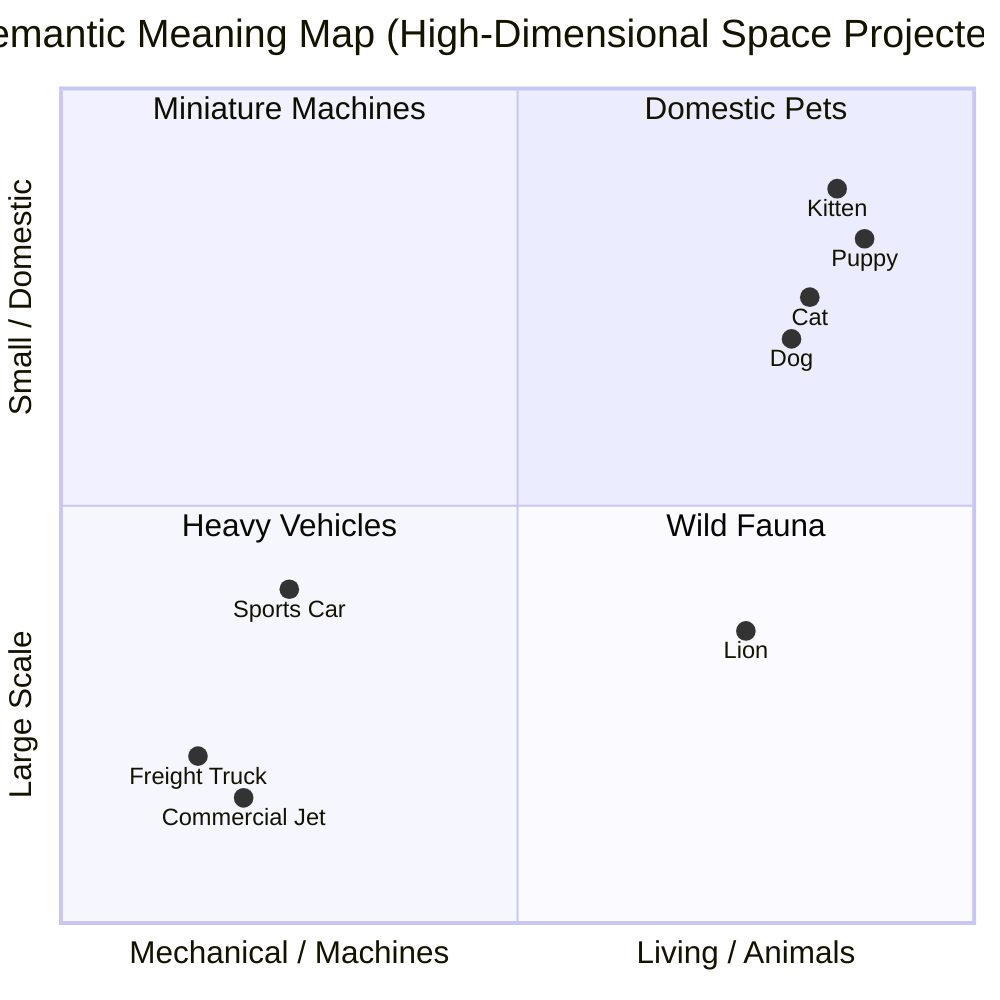
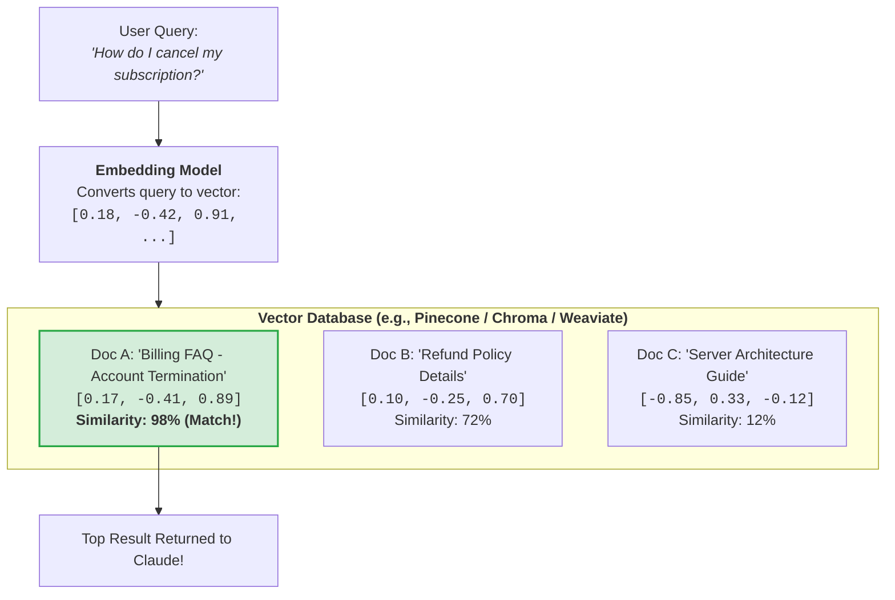
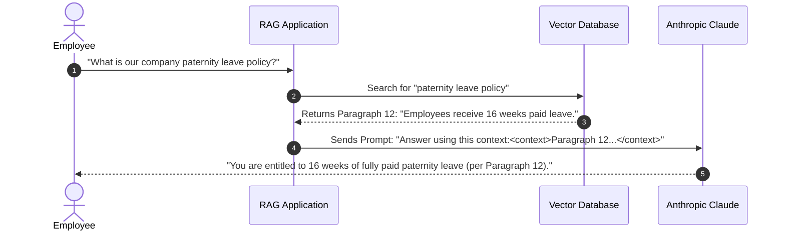
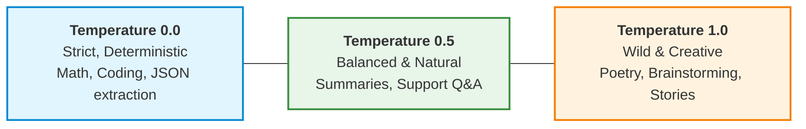

# 02. Architecture Deep Dives: Embeddings, Vector DBs & RAG

In this module, we tackle the three concepts that intimidate beginners the most: **Embeddings**, **Vector Databases**, and **RAG (Retrieval-Augmented Generation)**.

By using simple visual metaphors, we will show you that these are not mysterious black boxes, but rather intuitive tools designed to give AI an **accurate, long-term memory**.

---

## 1. Embeddings: GPS Coordinates for Human Ideas

### First Principles:
A computer has no idea what the word `"happy"` feels like, or that a `"puppy"` is a young `"dog"`. 
To allow computers to compare the *meanings* of words and documents, we convert words, sentences, or paragraphs into long lists of numbers called **Vectors**. This process is called creating an **Embedding**.

### The GPS Coordinate Analogy:
Think about physical locations on Earth:
- The **Eiffel Tower** is at latitude `48.8584° N`, longitude `2.2945° E`.
- The **Louvre Museum** is at latitude `48.8606° N`, longitude `2.3376° E`.
- Because these GPS numbers are very close to each other, Google Maps knows they are both in Paris!
- **Tokyo**, Japan (`35.6762° N`, `139.6503° E`) is numerically far away.

**Embeddings are simply GPS coordinates for human meaning!**

```text
CONCEPTUAL MEANING MAP (2D SIMPLIFICATION)
+-------------------------------------------------------------------------------+
|                                                                               |
|   [ Kitten ] (0.82, 0.91)           [ Luxury Sports Car ] (0.12, 0.25)        |
|          \                                   |                                |
|           [ Cat ] (0.85, 0.88)               |                                |
|                                     [ Electric Sedan ] (0.15, 0.28)           |
|                                                                               |
|   [ Golden Retriever ] (0.78, 0.72)                                           |
|          /                                                                    |
|   [ Puppy ] (0.75, 0.75)            [ Airplane ] (0.10, 0.82)                 |
|                                                                               |
+-------------------------------------------------------------------------------+
  <--- Domestic Pets Cluster --->       <--- Transportation Cluster --->
```



### The Magic of Vector Math:
Because meanings are represented as numbers, you can literally do math on concepts:
$$\text{Vector}(\text{"King"}) - \text{Vector}(\text{"Man"}) + \text{Vector}(\text{"Woman"}) \approx \text{Vector}(\text{"Queen"})$$
- If you take a royalty concept ("King"), subtract the masculine component ("Man"), and add the feminine component ("Woman"), the resulting GPS coordinates point directly to **"Queen"**!

---

## 2. Vector Databases: The Vibe-Based Smart Library

Now that you understand embeddings, what is a **Vector Database**?

### First Principles:
For 40 years, software used **Relational Databases (SQL)** like MySQL or PostgreSQL. 
SQL databases are brilliant at **exact matches**:
- `SELECT * FROM users WHERE email = 'john@example.com';`
- `SELECT * FROM products WHERE price < 50;`

However, relational databases are **terrible at understanding conceptual meaning**.
If a user searches your database for:
> *"A cozy warm outfit for a chilly winter morning"*

A traditional SQL database will search for the exact words `"cozy"`, `"warm"`, and `"chilly"`. If your product catalog lists a *"Wool Cashmere Sweater"*, SQL will return **zero results** because none of the exact keywords matched!

### The Music Curator Analogy:
- **Traditional Relational DB (SQL)**: Like an alphabetized physical record store bin. If you ask for the album titled `"Abbey Road"`, the clerk looks under 'A' and finds it instantly. But if you ask: *"Find me songs that feel nostalgic, melancholy, and sound like a rainy autumn evening"*, the alphabetized bin cannot help you.
- **Vector Database**: Like a world-class Spotify music curator. The curator doesn't care what letters are in the title; they understand the musical "vibe" (tempo, mood, instruments, emotion). They calculate the distance between your request and thousands of songs, handing you the 5 closest matches in milliseconds.

```text
+-----------------------+     +------------------------+     +----------------------+
| User Query:           |     | Embedding Model        |     | Vector Database      |
| "How to fix a leaking | --> | Converts to coordinates| --> | Searches coordinates |
| kitchen pipe"         |     | [0.34, -0.89, 0.12...] |     | Returns: Plumber     |
+-----------------------+     +------------------------+     | Repair Guide Page 4  |
                                                             +----------------------+
```



### Popular Vector Databases in the Real World:
- **Cloud Native**: Pinecone, Weaviate, Qdrant, Milvus.
- **Local / Lightweight**: ChromaDB, FAISS.
- **Hybrid (SQL + Vectors)**: PostgreSQL with the `pgvector` extension.

---

## 3. RAG (Retrieval-Augmented Generation): The Open-Book Exam

**RAG** is the single most important architecture in modern enterprise AI.

### First Principles:
Every LLM suffers from two major limitations:
1. **Knowledge Cutoff**: The model only knows what was on the internet when it was trained. It doesn't know what happened yesterday.
2. **Private Data Isolation**: Claude does not know your company's private HR policies, internal codebases, or customer records (and you wouldn't want public models trained on your private data anyway!).

So how do you get Claude to answer questions about your private 500-page internal company handbook?
You have two choices:
- **Option A: Retrain / Fine-tune the model**: Costs hundreds of thousands of dollars, takes weeks, and models can still hallucinate facts.
- **Option B: Use RAG (Retrieval-Augmented Generation)**: Free or ultra-cheap, takes seconds, and is 100% accurate.

### The Exam Analogy: Closed-Book vs. Open-Book
- **Without RAG (Closed-Book Exam)**: 
  Imagine a student sitting in an exam hall with no books or notes. When asked: *"What is Section 4.2 of Acme Corp's dental reimbursement policy?"*, the student has to guess based on general memories of dental insurance. They will likely **hallucinate** an answer that sounds convincing but is completely made up!
- **With RAG (Open-Book Exam with a Speed Assistant)**:
  The student sits at a desk with an eager research assistant. When the exam asks about Section 4.2, the assistant zips over to the file cabinet (the Vector DB), pulls out the exact one-page dental policy sheet, places it in front of the student, and says: *"Read this paragraph"*. The student (Claude) reads the exact words and quotes the answer with 100% precision.

```text
STEP 1: INGESTION (One-Time Setup)
Company PDFs/Docs ---> Chunk into small paragraphs ---> Generate Embeddings ---> Store in Vector DB

STEP 2: QUERY TIME (Every User Question)
User: "What is my dental allowance?"
           |
           v
Vector DB searches and finds: "Paragraph 4: Dental allowance is $1,500/yr"
           |
           v
Assemble Augmented Prompt:
  "Answer the user's question using ONLY this reference context:
   <context> Dental allowance is $1,500/yr </context>
   Question: What is my dental allowance?"
           |
           v
Claude outputs: "According to your company policy, your annual dental allowance is $1,500."
```



---

## 4. Temperature: The Spice Dial of Creativity

When you send a request to Claude's API, you can set a parameter called **Temperature** (usually between `0.0` and `1.0`).

### The Master Chef Analogy:
- **Temperature = 0.0 (The Strict Michelin Pastry Chef)**:
  - Follows the recipe to the exact microgram.
  - No improvisation, zero surprises.
  - Ask the same question 10 times, you get the exact same deterministic answer every time.
  - **Ideal for**: Financial calculations, legal compliance, JSON schema generation, code bug fixes.
- **Temperature = 0.5 (The Balanced Everyday Home Cook)**:
  - Follows the recipe faithfully, but adds a dash of personal flair to make it taste fresh.
  - **Ideal for**: General conversation, summarizing reports, drafting professional emails.
- **Temperature = 1.0 (The Experimental Jazz Chef)**:
  - Throws random spices into the pan, creates bizarre unexpected flavor fusions.
  - Highly creative, unexpected, poetic, and diverse.
  - **Ideal for**: Brainstorming marketing taglines, writing fantasy fiction, lateral thinking.

```text
DETERMINISTIC / REPEATABLE                          HIGHLY CREATIVE / RANDOM
Temperature 0.0                  Temperature 0.5             Temperature 1.0
+-------------------------------+---------------------------+-------------------------------+
| Strict Math, Code, Legal, JSON| Professional Memos, Blogs | Brainstorming, Poetry, Sci-Fi |
+-------------------------------+---------------------------+-------------------------------+
```



---

## 5. Prompt Caching: The Ultimate Speed and Cost Shortcut

Claude has an enormous 200,000-token context window. You can load a 400-page book into it. But what if you want to ask 20 consecutive questions about that same book?

Without caching:
- Every time you ask a question, the API sends the entire 400-page book again!
- You pay for those 150,000 tokens over and over.

### The Library Side-Table Analogy:
- **Without Caching**: Every time you want to check a fact, the librarian climbs a ladder, carries the giant 50-pound encyclopedia down to your desk, opens it, reads 1 line, and then carries the heavy book all the way back up to the shelf.
- **With Anthropic Prompt Caching**: The librarian leaves the heavy encyclopedia open right on your side table for 5 minutes. As long as you keep asking questions, reading from the already-open book is **instant** and gets a **90% cost discount**!

---

## 🏁 Summary of Core Insights
1. **Embeddings are GPS coordinates** representing the semantic meaning of ideas.
2. **Vector Databases search by "vibe and conceptual closeness"** rather than rigid keyword matching.
3. **RAG turns Claude from an anxious closed-book student into an accurate open-book scholar**.
4. **Temperature controls creativity**: Keep it low ($0.0$) for facts and code; bump it up for brainstorming.
5. **Prompt Caching keeps big documents open on the side table**, saving 90% in cost.

