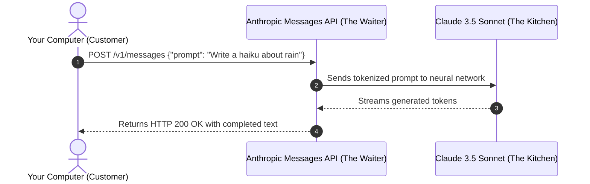
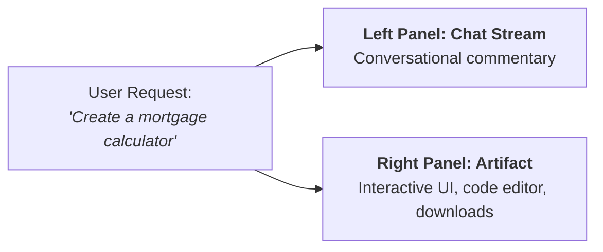

# 03. Hands-On Labs: From Claude.ai UI to Your First API Call

Even if you have **never written a single line of code in your life**, this module will guide you step-by-step through using Claude like a seasoned pro.

We start with **Zero-Code UI workflows** (Projects and Artifacts) and then gently walk you through your **very first 5-line Python API script**, explaining every single character in plain English.

---

## 🍽️ What is an API Anyway? (The Restaurant Waiter Analogy)

You will constantly hear developers talk about the "Anthropic API". What does that actually mean?

### The Restaurant Analogy:
1. **You are the Customer**: Sitting at the dining table with a menu.
2. **The Kitchen is Claude**: Deep inside Anthropic's data center, full of high-powered GPU supercomputers cooking up responses.
3. **The API is the Waiter**:
   - You cannot walk into the commercial kitchen and fiddle with the stoves.
   - Instead, you tell the waiter: *"I would like the pasta, please."* (Your API Request).
   - The waiter walks into the kitchen, gives the order to the chef, and carries the finished hot plate of food back to your table (The API Response).

```text
+-------------------+      +-------------------------+      +-------------------+
|    YOUR LAPTOP    | ---> |     ANTHROPIC API       | ---> |  ANTHROPIC CLOUD  |
|    (Customer)     |      |        (Waiter)         |      | (Kitchen / Model) |
| "Explain gravity" | <--- | Delivers response JSON  | <--- | Generates output  |
+-------------------+      +-------------------------+      +-------------------+
```



---

## 🧪 Lab 1: Exploring Claude.ai (No Code Required)

### 1. Claude Artifacts: The Dedicated Side Canvas
When you ask Claude on [claude.ai](https://claude.ai) to write a piece of code, design a game, create an SVG graphic, or write an extensive document (> 15 lines), Claude doesn't bury it inside the chat transcript. 

Instead, it triggers an **Artifact**:
- A dedicated interactive panel opens on the right side of the screen.
- You can edit the code, view live interactive previews (React apps, HTML charts), and copy or download it with one click.
- **Analogy**: Chat is like talking across a coffee table; Artifacts are like sliding a whiteboard next to the table so you can both work on the blueprint together.

```text
+----------------------------------+----------------------------------+
| CHAT STREAM (Left Window)        | ARTIFACT CANVAS (Right Window)   |
|                                  |                                  |
| User: "Can you design a modern   | +------------------------------+ |
| HTML landing page for my bakery?"| |  PASTRY DELIGHTS 🥐          | |
|                                  | |  [Order Fresh Croissants]    | |
| Claude: "Here is your bakery     | |                              | |
| landing page. You can preview    | |  * Fresh daily               | |
| the interactive design on the    | |  * 100% Organic Butter       | |
| right panel."                    | +------------------------------+ |
|                                  | [Code View] [Live Interactive]   |
+----------------------------------+----------------------------------+
```



---

### 2. Claude Projects: Your Team Knowledge Base
Need Claude to know everything about your business without pasting the same 10 files every single morning? Use **Claude Projects**:
1. Create a Project named *"Company Knowledge Base"*.
2. Upload up to 200,000 tokens worth of PDFs, manuals, and spreadsheets.
3. Define **Custom Project Instructions**: *"You are an internal HR assistant. Answer questions strictly according to our employee handbook."*
4. Every chat started inside that project automatically inherits that entire knowledge base!

---

## 🐍 Lab 2: Your Very First Python API Call

Let's write a real Python script. Even if you've never used Python, follow these 3 simple steps:

### Step 1: Install the Anthropic Python Library
Open your terminal (PowerShell or Command Prompt) and type:
```bash
pip install anthropic
```

### Step 2: Set Your API Key
Get an API key from [console.anthropic.com](https://console.anthropic.com). In your terminal, set it as an environment variable:
```powershell
# Windows PowerShell:
$env:ANTHROPIC_API_KEY="your-actual-api-key-here"
```

### Step 3: Run the Clean 8-Line Script
Create a file named `my_first_claude_call.py` and paste this code:

```python
import anthropic

# 1. Initialize the client (automatically finds your ANTHROPIC_API_KEY environment variable)
client = anthropic.Anthropic()

# 2. Call the Messages API
response = client.messages.create(
    model="claude-3-5-haiku-20241022",  # We use Haiku because it's fast and ultra-cheap!
    max_tokens=300,                     # Limit response length to 300 tokens
    messages=[
        {"role": "user", "content": "Explain what a Vector Database is in one sentence for a 10-year-old."}
    ]
)

# 3. Print the text response
print("Claude says:")
print(response.content[0].text)
```

### 🔍 Line-by-Line Code Breakdown:
- `import anthropic`: Imports the official Anthropic toolkit into Python.
- `client = anthropic.Anthropic()`: Creates our "digital phone" connected to Anthropic's servers.
- `client.messages.create(...)`: This is our waiter taking our order.
- `model="claude-3-5-haiku-..."`: Tells Anthropic which model brain to use.
- `max_tokens=300`: The safety cutoff so Claude doesn't ramble on forever.
- `response.content[0].text`: Unwraps the waiter's tray and extracts the pure text response.

---

## ⚡ Lab 3: The "Prefill Trick" (Eliminate Chit-Chat)

Notice how AI assistants often say:
> *"Sure! I would be delighted to help you write a JSON payload for your user data. Here is the JSON:"*

If you are building an automated system, that chit-chat breaks your software!
You can use **Assistant Message Prefill** to force Claude to output pure JSON:

```python
response = client.messages.create(
    model="claude-3-5-haiku-20241022",
    max_tokens=200,
    messages=[
        {"role": "user", "content": "Return the name and capital of France in JSON format."},
        # PREFILL: We prime Claude's mouth with the opening curly brace '{'
        {"role": "assistant", "content": "{"}
    ]
)

# Because Claude continues from '{', it outputs pure valid JSON with zero conversational filler!
print("{" + response.content[0].text)
```

**Output**:
```json
{
  "country": "France",
  "capital": "Paris"
}
```

---

## 🏁 Summary of Practical Skills Learned
1. **Artifacts** provide a dedicated side-panel for code, games, and large documents.
2. **Projects** give Claude a permanent 200k-token filing cabinet for your files.
3. An **API is just a digital waiter** sending structured requests and returning responses.
4. **Assistant Prefilling** is the secret sauce for clean, deterministic structured outputs.

