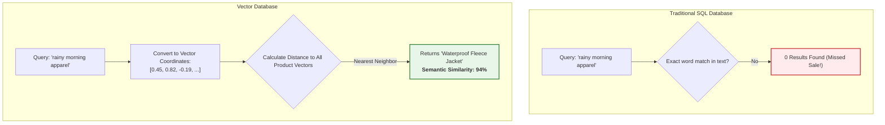

# Q&A 001: Vector Databases vs. Relational Databases (SQL) Explained for Beginners

**Date Added:** 2026-11-02  
**Target Domain:** Data Architecture, Embeddings & Vector Databases  
**Core Takeaway:** Relational databases search for exact words or numbers (`WHERE title = 'X'`), while Vector Databases search for conceptual meaning and similarity ("vibe matching") using mathematical distance.

---

## 1. First Principles: The Core Problem

For decades, applications relied on **Relational Databases (RDBMS / SQL)** such as PostgreSQL, MySQL, and Oracle. Relational databases are masterpieces of exactness:
- If a customer looks for order `#98412`, SQL finds it in 1 millisecond.
- If a bank asks for all accounts with `balance > 10000`, SQL filters them instantly.

### The Breakdown: When Exactness Fails
Human language is not exact. We use metaphors, synonyms, typos, and feelings:
- A user searches a retail store for: *"Cute warm outfit for walking my dog in the rain."*
- A traditional SQL query checks:
  ```sql
  SELECT * FROM products WHERE description LIKE '%cute warm outfit%';
  ```
- **Result:** `0 items found`.
- Why? Because the actual product title is: *"Waterproof Fleece-Lined Windbreaker"*. It contains **none** of the words the user typed, even though it is the **exact product** the user wants!

---

## 2. Real-World Analogy: The Alphabetical Bin vs. The Music Guru

### The Relational Database (SQL) is the Alphabetical Record Bin:
Imagine walking into a vintage vinyl record store. The clerk says: *"All 50,000 records are organized in alphabetical order by artist last name."*
- If you ask: *"Do you have 'Thriller' by Michael Jackson?"* $\to$ The clerk flips to 'J', finds Jackson, and hands it to you in 3 seconds.
- But if you ask: *"Can you find me something that sounds like sitting in a quiet coffee shop in Seattle while watching raindrops roll down the window?"* $\to$ The clerk stares blankly. The alphabetical bin has no way to answer that question.

### The Vector Database is the Genius Music Curator:
Now imagine walking into a boutique shop run by a musical savant:
- The curator doesn't care about the spelling of the band's name.
- They have listened to every record and mapped its **tempo, mood, acoustic warmth, and emotional vibe**.
- When you describe that Seattle rainy day feeling, the curator immediately reaches into a specific shelf and hands you three acoustic jazz and indie records that evoke that exact feeling.

```text
RELATIONAL DATABASE (SQL)                    VECTOR DATABASE
+-------------------------------+            +-------------------------------+
| Finds EXACT words or numbers  |            | Finds SIMILAR ideas & vibes   |
| "WHERE user_id = 42"          |            | "Find docs near this meaning" |
| Keyword matching              |            | Semantic similarity           |
| Rigid structure (Columns/Rows)|            | Multi-dimensional coordinates |
+-------------------------------+            +-------------------------------+
```



---

## 3. Under the Hood: How Vector DBs Actually Work

1. **Text to Numbers (Embedding)**:
   Every piece of text (a paragraph from a PDF, a product description, a question) is passed through an **Embedding Model**. The model outputs an array of numbers (e.g., 1,536 numbers long) representing its position in high-dimensional space.
2. **Spatial Distance (Cosine Similarity)**:
   When two ideas are related, their vector arrows point in almost the same direction in geometry. The angle between them is close to $0^\circ$ (Cosine Similarity $\approx 1.0$).
3. **Nearest Neighbor Indexing (HNSW)**:
   Vector databases use special algorithms (like Hierarchical Navigable Small World, or HNSW) to search through 10 million vectors in 15 milliseconds without having to check every single vector one-by-one.

---

## 4. Architectural Comparison Matrix

| Feature | Relational Database (SQL) | Vector Database (VDB) |
| :--- | :--- | :--- |
| **Primary Data Unit** | Tables, Rows, Columns | High-dimensional Vectors (Points in space) + Metadata |
| **Search Mechanism** | Exact match (`=`), Substring (`LIKE`), Range (`>`) | Approximate Nearest Neighbor (ANN, Cosine Distance) |
| **Input Type** | Structured data (IDs, dates, prices, names) | Unstructured data (Text, PDFs, Images, Audio, Code) |
| **Understands Synonyms?** | No (unless manually hardcoded) | Yes, inherently through language models |
| **Query Speed** | Microseconds for indexed primary keys | Milliseconds for vector distance calculations |
| **Leading Technologies** | PostgreSQL, MySQL, SQL Server, Oracle | Pinecone, ChromaDB, Weaviate, Qdrant, Milvus, pgvector |

---

## 5. Common Beginner Pitfall / Exam Trap

> [!WARNING] **The "Replace Everything" Trap**:
> Beginners often ask: *"Does a Vector Database replace my SQL database?"*
> **Answer: Absolutely NOT!**
> You still need SQL to record orders, debit bank balances, manage user logins, and track inventory. A Vector Database is an **add-on cognitive search engine** used alongside your traditional database to power AI features like RAG, recommendations, and semantic search.

