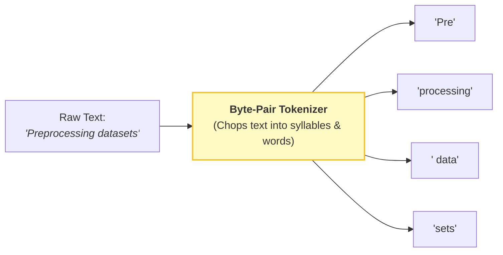
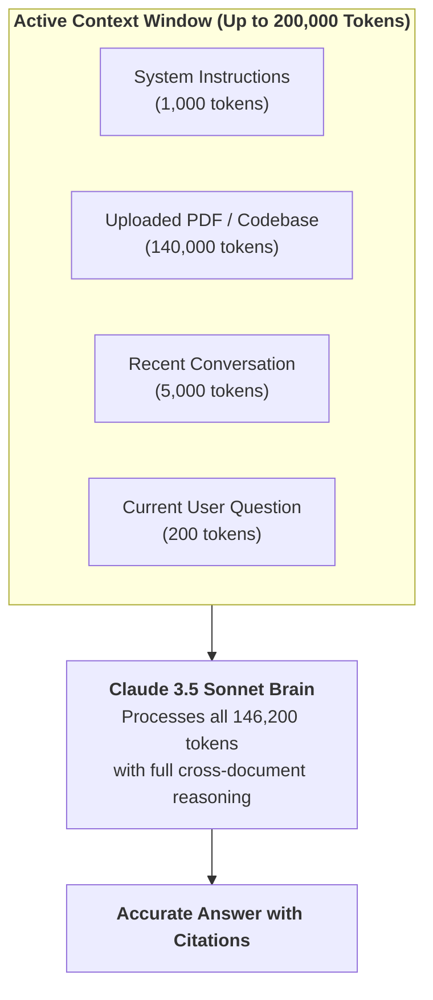

# Q&A 002: Tokens vs. Words & The Context Window Explained Simply

**Date Added:** 2026-11-02  
**Target Domain:** Prompt Mechanics, Tokenization & Context Architecture  
**Core Takeaway:** LLMs do not read words or letters; they process chunks of text called "tokens" (~0.75 words each). The "Context Window" is the model's short-term executive desk space that limits how many tokens it can examine at once.

---

## 1. First Principles: Why Don't LLMs Just Read Words?

Beginners naturally assume that when they type a sentence into Claude, the computer reads the words just like a human does. Why don't AI engineers just make LLMs read words?

### The Two Failed Extremes:
1. **Reading Letter-by-Letter (Character Level)**:
   - If an AI read one letter at a time (`c-a-t`), it would take thousands of computational steps just to read one paragraph. The model would spend so much effort tracking spelling that it would struggle with higher-level logic and meaning.
2. **Reading Whole Words (Word Level)**:
   - How many words exist in English? Hundreds of thousands! Add plurals (`cats`), past tenses (`walked`), misspellings (`definately`), emojis (`🚀`), and programming code (`get_user_by_id()`), and the dictionary becomes infinite. A neural network cannot manage a dictionary of 10 million unique words.

### The Engineering Solution: Sub-Word Tokens (BPE)
Engineers invented **Byte-Pair Encoding (BPE)**:
- Common words get their own single token (`the`, `dog`, `run`).
- Longer or rarer words are chopped into syllables or root parts: `unbreakable` $\to$ `["un", "break", "able"]`.
- This keeps the vocabulary size manageable (~100,000 tokens) while being able to express literally any text or code in any language!

---

## 2. Real-World Analogy: The LEGO Brick Construction

Imagine building a miniature house out of LEGOs:
- A standard brick or roof tile is like a common word (1 token).
- A custom medieval castle turret doesn't have its own single piece. Instead, you snap 3 smaller standard curved blocks together (3 tokens).
- The master builder doesn't carve every microscopic plastic molecule from scratch (character-level), nor do they buy a pre-molded entire plastic house (word-level). They build efficiently using modular LEGO blocks!

```text
SENTENCE:       "Artificial intelligence is transforming industries."

TOKEN CHUNKS:   ["Art", "ificial", " intelligence", " is", " transforming", " industries", "."]

TOKEN COUNT:    7 Tokens for 5 Words (Ratio: ~1.4 tokens per word)
```



---

## 3. The Context Window: The Physical Executive Desk

### The Mental Model:
Think of Claude as an executive sitting in an office:
- **Your Prompt & Previous Messages** are physical printed sheets of paper laid out flat on top of the desk.
- **The Context Window** is the physical surface area of the desk.
- When Claude generates an answer, its **Self-Attention Mechanism** allows it to scan across **all sheets currently resting on the desk** simultaneously.
- If you keep piling on documents until the desk is overflowing, older sheets get pushed off the edge onto the floor. Claude literally cannot see or refer to them anymore.

```text
+-------------------------------------------------------------------------------+
|                            CLAUDE'S EXECUTIVE DESK                            |
|                            (200,000 TOKEN CAPACITY)                           |
|                                                                               |
|   +-------------------+    +--------------------+    +--------------------+   |
|   | System Prompt     |    | 200-Page PDF Manual|    | Past Chat Turns    |   |
|   | (Persona & Rules) |    | (Financial Report) |    | (Questions/Answers)|   |
|   +-------------------+    +--------------------+    +--------------------+   |
|                                                                               |
|   +-------------------+                                                       |
|   | Latest Question   |   <--- ALL OF THIS FITS ON THE DESK AT ONCE!          |
|   +-------------------+                                                       |
+-------------------------------------------------------------------------------+
```



### Why Claude's 200,000 Context Window is Revolutionary:
Early AI models had desks the size of a coffee saucer (4,000 tokens $\approx$ 3,000 words). If you pasted a 15-page document, the beginning was forgotten by the time it reached the end!

**Anthropic Claude gives every user a 200,000-token banquet table:**
- **~150,000 English words**
- **~500 pages of text**
- You can feed entire technical specifications, books, or legal contracts into a single prompt without chunking or losing context.

---

## 4. Quick Rule of Thumb & Math Cheat Sheet

| Metric | Rough Conversion |
| :--- | :--- |
| **1 Token** | $\approx$ 0.75 words (or ~4 characters in English) |
| **100 Tokens** | $\approx$ 75 words |
| **1,000 Tokens** | $\approx$ 750 words (about 1.5 single-spaced pages) |
| **10,000 Tokens** | $\approx$ 7,500 words (a full academic thesis chapter) |
| **200,000 Tokens** | $\approx$ 150,000 words (an entire novel or thick software handbook) |

---

## 5. Common Beginner Pitfall: The "Strawberry" Problem

> [!WARNING] **The Classic Letter Counting Trap**:
> Why do LLMs often fail when you ask: *"How many letters 'r' are in 'strawberry'?"*
> 
> Because Claude doesn't see the individual letters `s-t-r-a-w-b-e-r-r-y`. The tokenizer bundles the word into two tokens: `["straw", "berry"]`.
> The model's attention mechanism sees the token `straw` and the token `berry`—it never inspects the underlying character array unless you explicitly instruct it:
> *"Spell the word out character-by-character separated by hyphens (s-t-r-a-w-b-e-r-r-y), and count each 'r' one by one."*

