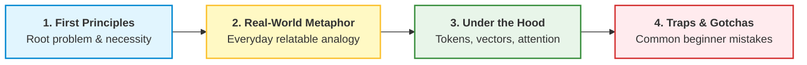

# 🌟 AI & LLM Foundations for Absolute Beginners: Zero to Claude Hero

Welcome to the **AI & LLM Foundations for Absolute Beginners** track! This course is purposefully engineered for newcomers who want to understand Artificial Intelligence, Large Language Models (LLMs), Vector Databases, and Anthropic Claude **without drowning in heavy mathematical jargon or assuming any prior AI background**.

Every complex concept is anchored in **everyday real-world analogies**, accompanied by **dual visual diagrams (ASCII + Mermaid)**, and broken down from first principles to give you an intuitive, rock-solid mental model.

---

## 🧭 Course Philosophy: The "Mental Model First" Approach

Learning AI shouldn't feel like reading a PhD research paper. We use a 4-step learning formula:
1. **First Principles**: What fundamental human problem does this technology solve?
2. **Real-World Analogy**: What everyday object, profession, or experience is this identical to?
3. **Under the Hood**: How do the computers, numbers, and models actually compute it?
4. **Common Pitfalls & Gotchas**: What misconceptions trip up 90% of beginners?

```text
+---------------------+     +----------------------+     +---------------------+
| 1. FIRST PRINCIPLES | --> | 2. REAL-WORLD ANALOGY| --> | 3. UNDER THE HOOD   |
| (Why does it exist?)|     | (Relatable metaphor) |     | (Tokens, Math, VDB) |
+---------------------+     +----------------------+     +---------------------+
                                                                    |
                                                                    v
                                                         +---------------------+
                                                         | 4. GOTCHA & PITFALL |
                                                         | (Avoid rookie traps)|
                                                         +---------------------+
```



---

## 🗺️ Master Curriculum Modules

This course is organized into 8 modular learning hubs matching our repository standards:

| Module Directory | Title | Core Beginner Focus |
| :--- | :--- | :--- |
| [**00_roadmap_and_study_plan/**](./00_roadmap_and_study_plan/README.md) | **Beginner Roadmap & Learning Path** | A gentle 14-day step-by-step pacing guide transitioning from zero knowledge to Claude Associate readiness. |
| [**01_core_concepts_and_fundamentals/**](./01_core_concepts_and_fundamentals/README.md) | **The AI & LLM Vocabulary Decoder** | What is AI vs ML vs Deep Learning vs LLM? How do models think? What is a token? Why context windows matter. |
| [**02_architecture_and_deep_dives/**](./02_architecture_and_deep_dives/README.md) | **Vector DBs, Embeddings & RAG Explained Simply** | What are Embeddings (GPS for ideas)? What is a Vector Database (Vibe-based library)? How does RAG give Claude an open textbook? |
| [**03_hands_on_labs_and_code/**](./03_hands_on_labs_and_code/README.md) | **Hands-On Lab: Claude from UI to First API Call** | Zero-to-one practical lab: Using Claude.ai, Projects, Artifacts, and running your very first Python API script with clear explanations. |
| [**04_observability_security_and_ops/**](./04_observability_security_and_ops/README.md) | **Safety, Hallucinations & Guardrails** | Why AI makes things up (Hallucinations), Constitutional AI (Claude's conscience), and how prompt injection (Trojan horses) works. |
| [**05_scenario_questions_and_drills/**](./05_scenario_questions_and_drills/README.md) | **Beginner Scenario Practice Drills** | 10 high-yield multiple-choice questions with deep explanations of right answers and distractors. |
| [**08_qa_and_doubt_clearing/**](./08_qa_and_doubt_clearing/INDEX.md) | **Auto-Persisting Beginner Q&A Hub** | Deep-dive explanations for common doubts (Vector DBs vs SQL, Tokens vs Words, Temperature). |

---

## ⚡ The Ultimate AI Terms Rosetta Stone

Before you read any chapter, here is how the most confusing buzzwords translate into everyday life:

| Technical Buzzword | What People Think It Means | What It Actually Is (Real-World Analogy) |
| :--- | :--- | :--- |
| **Artificial Intelligence (AI)** | Conscious sci-fi robot | Any computer program performing a task that once required human judgment (like playing chess or sorting spam). |
| **Machine Learning (ML)** | The computer is thinking | A computer finding statistical patterns in past data instead of being given hand-coded `if/else` rules. (Like learning to spot fraudulent cards by looking at 1,000,000 transactions). |
| **Large Language Model (LLM)** | A super-intelligent digital brain | An ultra-advanced "autocomplete" engine that has read millions of books and predicts the most logical next word. |
| **Token** | A single word | A bite-sized piece of text (roughly 3/4 of a word or 4 characters). LLMs don't read words or letters; they eat tokens like LEGO bricks. |
| **Context Window** | The AI's permanent memory | The AI's **short-term desk space** (RAM). Anything on the desk can be seen; anything not on the desk is forgotten. |
| **Embedding** | Fancy high-dimensional math | A **GPS coordinate of meaning**. In Google Maps, Paris and Lyon are close. In embedding space, "Cat" and "Kitten" sit right next to each other. |
| **Vector Database** | A normal SQL table with numbers | A **vibe-based smart library**. While SQL searches for exact keywords (`WHERE name = 'iPhone'`), a Vector DB searches for matching ideas (`Find gadgets for mobile productivity`). |
| **RAG (Retrieval-Augmented Generation)** | Fine-tuning / Training an AI | An **open-book exam**. Instead of memorizing your internal company PDFs, Claude searches a drawer, finds the exact page, and reads it before answering. |
| **Temperature** | Heat of the CPU | The **spice level of creativity**. Low temperature ($0.0$) = strict recipe follower. High temperature ($1.0$) = wild jazz improviser. |
| **System Prompt** | Secret developer hack | The **employee job description**. It tells Claude who it is, how to behave, and what rules it must never break. |
| **Prompt Prefill** | Cheating the AI | Putting the first words into Claude's mouth (e.g. `{"status":`) to force it to answer cleanly without polite greetings. |

---

## 🌉 How This Connects to the Associate Certification

Once you complete this foundational course:
1. You will have an intuitive, jargon-free grasp of all core AI mechanics.
2. You can smoothly transition into our [Claude Certified Associate - Foundations Certification](../Claude%20Certified%20Associate%20-%20Foundations%20Certification/README.md) hub to prepare for the official Anthropic exam!

