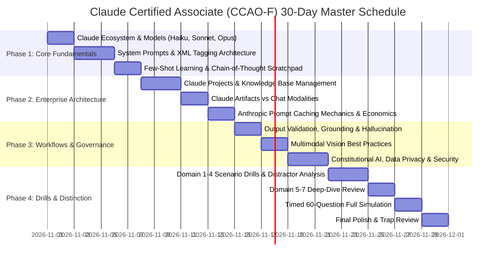

# 00. Master Roadmap & 30-Day Study Plan

Welcome to the structured study plan for the **Claude Certified Associate - Foundations (CCAO-F)** certification. This 30-day curriculum is designed to take you from initial familiarity to a **900+/1000 score with Distinction**, blending theoretical rigor with hands-on prompt engineering.

---

## 📅 High-Level 4-Phase Milestone Architecture

```text
+-----------------------+     +-----------------------+     +-----------------------+     +-----------------------+
|  PHASE 1: DAYS 1-7    |     |  PHASE 2: DAYS 8-14   |     |  PHASE 3: DAYS 15-21  |     |  PHASE 4: DAYS 22-30  |
|  Claude Core & Prompt | --> |  Enterprise Surfaces, | --> |  Workflows, Safety,   | --> |  Full-Length Scenarios|
|  Engineering Mastery  |     |  Projects & Caching   |     |  Governance & Vision  |     |  & Exam Readiness     |
+-----------------------+     +-----------------------+     +-----------------------+     +-----------------------+
```



---

## 🎯 Exam Blueprint & Weightage Distribution

| Domain # | Domain Name | Exam Weight | Key Focus Areas |
| :---: | :--- | :---: | :--- |
| **Domain 1** | Prompting and Task Execution | **24%** | XML tags (`<context>`, `<rules>`), system prompts, few-shot canonical examples, prefilling assistant responses, chain-of-thought scratchpads. |
| **Domain 2** | Output Evaluation and Validation | **14%** | Factual grounding, citation requirements, schema compliance (JSON), fallback instructions for missing info. |
| **Domain 3** | Product and Model Selection | **16%** | Trade-offs between Haiku (speed/cost), Sonnet (balance/coding), and Opus (deep reasoning); selecting Chat vs Projects vs Artifacts vs API. |
| **Domain 4** | Workflow Integration and Solution Design | **14%** | Human-in-the-loop review gates, multi-step pipeline chaining, document parsing, multimodal vision processing. |
| **Domain 5** | Configuration and Knowledge Management | **12%** | Claude Projects setup, 200k project knowledge, custom project instructions, Prompt Caching (1024/2048 token thresholds, 5-min TTL). |
| **Domain 6** | Governance, Risk, and Responsible Use | **10%** | Constitutional AI (HHH: Helpful, Honest, Harmless), commercial zero-data-training guarantee, prompt injection mitigations, PII handling. |
| **Domain 7** | Troubleshooting and Optimization | **10%** | Debugging lazy/hallucinatory responses, parameter tuning (temperature, top_p), token budget optimization. |

---

## 🗓️ Detailed 30-Day Daily Study Breakdown

### Week 1 (Days 1–7): Foundations & Prompt Engineering Mastery
- [ ] **Day 1**: Introduction to Anthropic & The Claude Model Family (Claude 3 / 3.5 / 3.7 architecture, Haiku vs Sonnet vs Opus specs).
- [ ] **Day 2**: The Anatomy of an Anthropic Prompt (System prompt vs User prompt vs Assistant prefill).
- [ ] **Day 3**: XML Tagging Architecture (`<instructions>`, `<context>`, `<rules>`, `<examples>`, `<output_format>`).
- [ ] **Day 4**: Few-Shot Learning Patterns (Crafting high-leverage canonical examples without prompt bloat).
- [ ] **Day 5**: Chain-of-Thought (CoT) and Scratchpad Reasoning (Directing Claude to think inside `<thinking>` tags).
- [ ] **Day 6**: Assistant Response Prefilling (Techniques to eliminate conversational preamble and force strict JSON/XML).
- [ ] **Day 7**: Phase 1 Milestone Check & 15 Scenario Drills on Prompting.

### Week 2 (Days 8–14): Enterprise Features, Projects & Caching
- [ ] **Day 8**: Claude Projects Deep-Dive (Knowledge Base creation, file types, 200k token context, project visibility).
- [ ] **Day 9**: Project Custom Instructions (Global behavioral conditioning across team members).
- [ ] **Day 10**: Claude Artifacts (When Claude triggers artifacts vs inline chat, interactive HTML/React/SVG, reusability).
- [ ] **Day 11**: Prompt Caching Architecture (How KV caching works, 5-minute sliding TTL, cache write vs cache read costs).
- [ ] **Day 12**: Prompt Caching Thresholds (1024 token minimum for Sonnet/Opus, 2048 for Haiku, structuring static vs dynamic content).
- [ ] **Day 13**: API vs Web Surfaces (Anthropic Console, Workbench, Messages API parameters).
- [ ] **Day 14**: Phase 2 Milestone Check & Caching/Projects Scenario Drills.

### Week 3 (Days 15–21): Workflows, Validation, Vision & Governance
- [ ] **Day 15**: Output Evaluation & Hallucination Mitigation (Grounding with explicit fallback constraints).
- [ ] **Day 16**: Structured Output Enforcement (JSON schema, Pydantic patterns, regex validation).
- [ ] **Day 17**: Multimodal Vision (Image resolution guidelines, document OCR, chart & diagram interpretation).
- [ ] **Day 18**: Human-in-the-Loop (HITL) Architectures & Escalation Gates.
- [ ] **Day 19**: Constitutional AI & Responsible Scaling Policy (Anthropic's HHH framework, RL from AI Feedback).
- [ ] **Day 20**: Data Privacy & Enterprise Trust (Zero training on commercial customer data, SOC2 Type II, HIPAA compliance).
- [ ] **Day 21**: Prompt Injection & Jailbreak Defenses (Defending against indirect prompt injections using XML isolation).

### Week 4 (Days 22–30): Drills, Mock Simulations & Final Readiness
- [ ] **Day 22**: Troubleshooting Degraded Outputs (Temperature, top_p, system prompt conflicts).
- [ ] **Day 23**: Domain 1 & 2 High-Yield Scenario Drill (20 questions with distractor analysis).
- [ ] **Day 24**: Domain 3 & 4 High-Yield Scenario Drill (20 questions with distractor analysis).
- [ ] **Day 25**: Domain 5, 6 & 7 High-Yield Scenario Drill (20 questions with distractor analysis).
- [ ] **Day 26**: Full 60-Question Timed Mock Simulation (120 minutes).
- [ ] **Day 27**: Deep Failure Analysis (Cataloging every missed question into `08_qa_and_doubt_clearing/`).
- [ ] **Day 28**: Exam Trap Review (Canonical rules, false assumptions, Pearson VUE gotchas).
- [ ] **Day 29**: Final High-Yield Formula & Cheat Sheet Memorization.
- [ ] **Day 30**: Exam Day Execution (Pre-test check, time management, scoring 900+ with Distinction).
