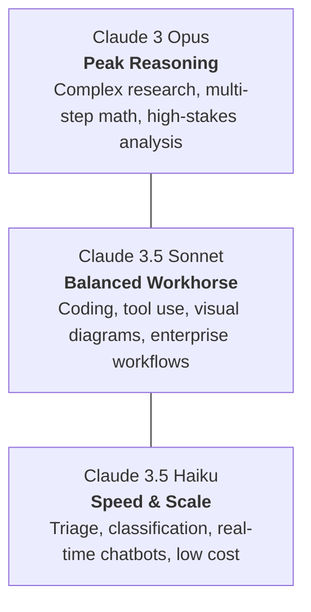
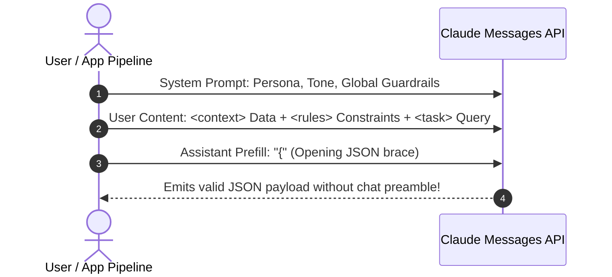

# 01. Core Concepts & Fundamentals

This module covers the core architectural building blocks of Anthropic's Claude, its underlying model family, prompt anatomy, and the canonical XML tagging system tested in **Domain 1 (Prompting and Task Execution)** and **Domain 3 (Product and Model Selection)** of the CCAO-F exam.

---

## 🏛️ The Claude Model Family Hierarchy

Anthropic categorizes its models into three distinct tiers based on intelligence, latency, and cost economics.

```text
+---------------------------------------------------------------------------------+
|                                 CLAUDE 3 OPUS                                   |
|                Maximum Intelligence | Deep Academic & Legal Reasoning           |
+---------------------------------------------------------------------------------+
                                       |
                                       v
+---------------------------------------------------------------------------------+
|                               CLAUDE 3.5 SONNET                                 |
|               Gold Standard for Coding, Reasoning & Multimodal Vision           |
+---------------------------------------------------------------------------------+
                                       |
                                       v
+---------------------------------------------------------------------------------+
|                                CLAUDE 3.5 HAIKU                                 |
|                  Lightning Fast | High-Throughput | Ultra Cost-Effective        |
+---------------------------------------------------------------------------------+
```



### Detailed Model Comparison Matrix

| Feature / Metric | Claude 3.5 Haiku | Claude 3.5 Sonnet | Claude 3 Opus |
| :--- | :--- | :--- | :--- |
| **Primary Strength** | Blazing speed, sub-second latency, low cost | Superior coding, reasoning, visual comprehension | Deep conceptual research, nuanced text synthesis |
| **Context Window** | 200,000 tokens (~150,000 words) | 200,000 tokens (~150,000 words) | 200,000 tokens (~150,000 words) |
| **Max Output Tokens** | 8,192 tokens | 8,192 tokens | 4,096 tokens |
| **Vision Support** | Yes (multimodal) | Yes (industry-leading multimodal) | Yes (multimodal) |
| **Prompt Caching** | Yes (min 2,048 tokens) | Yes (min 1,024 tokens) | Yes (min 1,024 tokens) |
| **Typical Use Cases** | Customer support triage, quick tagging, high-volume batch classification | Full-stack coding, agentic planning, multi-document analysis | Academic literature review, high-stakes contract critique |

---

## 📐 The Anatomy of an Anthropic Prompt

An enterprise-grade Claude prompt separates **system directives**, **reference context**, **task instructions**, and **formatting expectations**.

```text
+-----------------------------------------------------------------------+
|  SYSTEM PROMPT: Role, Global Guardrails, Operating Personas          |
+-----------------------------------------------------------------------+
|  USER MESSAGE:                                                        |
|    <context> [Reference Knowledge / RAG Documents] </context>         |
|    <rules> [Constraints, Fallbacks, Output Format] </rules>           |
|    <examples> [Canonical Input/Output Demonstrations] </examples>     |
|    <instructions> [Specific user task] </instructions>                |
+-----------------------------------------------------------------------+
|  ASSISTANT PREFILL: "{" or "<response>" (Forces deterministic schema) |
+-----------------------------------------------------------------------+
```



---

## 🏷️ Why Anthropic Recommends XML Tags

Anthropic trained Claude explicitly to recognize XML tags as semantic boundaries. Unlike standard Markdown headers (`#`, `##`), XML tags:
1. **Prevent Instruction Leakage**: Claude distinctly isolates raw user inputs from system rules.
2. **Eliminate Prompt Injections**: Untrusted external data enclosed in `<user_input>` cannot easily override instructions inside `<system_rules>`.
3. **Enhance Multi-Document RAG**: Multiple source files can be clearly differentiated using attributes: `<document id="doc_1">...</document>`.

### Canonical XML Tag Hierarchy
```xml
<system>
You are an expert technical auditor for cloud enterprise systems.
</system>

<context>
Here is the operational log snippet:
<log_entry timestamp="2026-11-02T12:00:00Z" status="500">
Database connection pool exhausted.
</log_entry>
</context>

<rules>
1. Base your diagnosis strictly on the provided log entry.
2. If the root cause cannot be determined with certainty, state "INSUFFICIENT_EVIDENCE".
3. Provide your technical response in JSON format.
</rules>

<task>
Analyze the log entry and identify the failure category and suggested remediation.
</task>
```

---

## 🧠 Chain-of-Thought (CoT) & Scratchpad Thinking

For complex reasoning tasks, prompting Claude to think before responding significantly improves factual accuracy and reduces logical errors.

```xml
<instructions>
Before providing your final recommendation, write out your step-by-step 
evaluation inside <thinking> tags. Evaluate:
1. Evidence supporting the claim.
2. Potential counter-arguments.
3. Final verdict.

After the </thinking> tag, provide your final response inside <verdict> tags.
</instructions>
```

---

## 🎛️ Hyperparameters: Temperature and Top-P

| Parameter | Range | Recommended Value for CCAO-F Scenarios | Architectural Purpose |
| :--- | :---: | :---: | :--- |
| **`temperature`** | `0.0` to `1.0` | `0.0` for structured data extraction, classification, code evaluation.<br/>`0.7` - `1.0` for creative writing and brainstorming. | Controls randomness. Lower values make token selection deterministic. Higher values increase diversity. |
| **`top_p`** | `0.0` to `1.0` | `0.9` (default) or left unchanged when temperature is `0.0`. | Nucleus sampling: cuts off the tail of low-probability tokens. (Anthropic recommends altering either temperature or top_p, not both). |
| **`max_tokens`** | Integer | Set according to expected output size (up to 8,192). | Maximum tokens Claude can generate in the response. Required in the Messages API. |

---

## ⚠️ Exam Trap Warnings for Domain 1 & 3

> [!WARNING]
> **Exam Trap 1: Relying on Adjectives Instead of Constraints**
> Writing *"Please be very accurate and concise"* is an anti-pattern. The exam tests whether you use **explicit constraints** (e.g., *"Respond in under 3 sentences using only facts present in <context>"*).

> [!WARNING]
> **Exam Trap 2: Model Over-Provisioning**
> If a scenario describes a pipeline that processes 50,000 incoming support tickets per hour for spam classification, choosing **Claude 3 Opus** is INCORRECT. The correct choice is **Claude 3.5 Haiku** due to cost and latency requirements.

> [!WARNING]
> **Exam Trap 3: Assistant Prefill vs System Prompt**
> A system prompt instructs Claude on *how* to behave, but only **Assistant Message Prefill** directly controls the exact starting token of Claude's turn to guarantee zero preamble.
