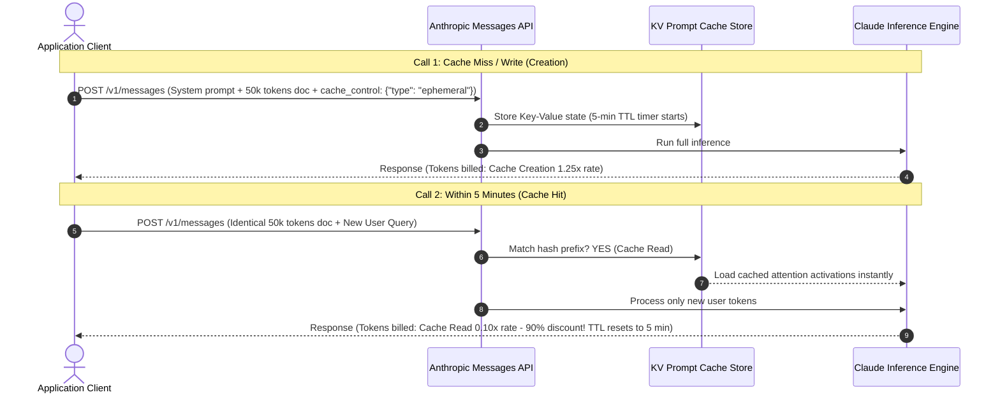
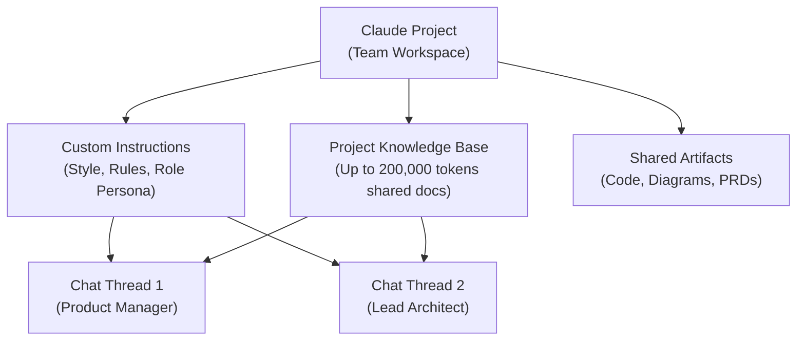

# 02. Architecture & Deep Dives

This module covers enterprise production architectures, scaling trade-offs, and advanced features tested in **Domain 4 (Workflow Integration and Solution Design)** and **Domain 5 (Configuration and Knowledge Management)** of the CCAO-F exam.

---

## ⚡ Anthropic Prompt Caching Architecture

Prompt Caching is one of Anthropic's most distinctive enterprise capabilities. It allows developers to cache frequently reused context (such as large codebases, reference documentation, or standard system instructions) in the model's memory.

```text
Request 1 (Initial Cache Write):
+-------------------------------------------------------+---------------------+
| Static Context: API Specs, Docs (>1024 Tokens)        | User Query 1        |
| Cost: 1.25x Normal Base Input Cost (Cache Write)      | Normal Token Cost   |
+-------------------------------------------------------+---------------------+
                                   |
                                   v  [5-Minute Sliding TTL Window]
Request 2 (Cache Hit):
+-------------------------------------------------------+---------------------+
| Static Context: API Specs, Docs (CACHE HIT!)          | User Query 2        |
| Cost: 0.10x Normal Base Input Cost (90% SAVINGS!)     | Normal Token Cost   |
+-------------------------------------------------------+---------------------+
```



### Prompt Caching Canonical Rules & Constraints

1. **Prefix Matching Requirement**: The cached prefix must be identical byte-for-byte. Place **static** content at the top and **dynamic** content at the bottom.
2. **Minimum Token Thresholds**:
   - **Claude 3.5 Sonnet & Claude 3 Opus**: Minimum **1,024 tokens**.
   - **Claude 3.5 Haiku**: Minimum **2,048 tokens**.
   - Prompts below these thresholds cannot be cached and will trigger normal input billing.
3. **Sliding 5-Minute TTL**: Every cache hit resets the 5-minute expiration clock.
4. **Economic Break-Even**:
   - Cache Write = `1.25x` regular input token price.
   - Cache Read = `0.10x` regular input token price.
   - Break-even occurs on the **very second request**!

---

## 📂 Claude Projects: Enterprise Knowledge Architecture

**Claude Projects** (`claude.ai`) provide non-technical and enterprise teams with an autonomous, collaborative environment.

```text
+---------------------------------------------------------------------------------+
|                                 CLAUDE PROJECT                                  |
|                                                                                 |
|  +---------------------------------------------------------------------------+  |
|  | Project Custom Instructions (Applied automatically to every chat session) |  |
|  +---------------------------------------------------------------------------+  |
|                                                                                 |
|  +---------------------------------------------------------------------------+  |
|  | Project Knowledge Base (Up to 200,000 tokens of PDFs, Markdown, Code)     |  |
|  +---------------------------------------------------------------------------+  |
|                                      |                                          |
|            +-------------------------+-------------------------+                |
|            |                                                   |                |
|            v                                                   v                |
|   +-------------------+                               +-------------------+     |
|   |   Chat Thread A   |                               |   Chat Thread B   |     |
|   | (Member 1 Query)  |                               | (Member 2 Query)  |     |
|   +-------------------+                               +-------------------+     |
+---------------------------------------------------------------------------------+
```



### When to Use Projects vs Artifacts vs Standard Chat

| Surface | Best Used For | Key Capabilities | Persistence & Sharing |
| :--- | :--- | :--- | :--- |
| **Standard Claude Chat** | Ad-hoc, one-off questions, exploratory brainstorming | Ephemeral context, quick turnaround | Private to user; no shared persistent knowledge |
| **Claude Projects** | Multi-document team initiatives, persistent domain guidelines | Pre-loaded 200k token knowledge base, custom project instructions | Shared across team workspace; persistent |
| **Claude Artifacts** | Standalone code files, interactive web apps, SVG graphics, PRDs | Side-by-side dedicated editor panel, instant code rendering | Downloadable, editable, shareable directly |
| **Messages API** | Production software, custom RAG pipelines, microservices | Headless automation, fine-grained temperature, prompt caching | Managed by developer application database |

---

## ⚖️ Architectural Trade-off: 200k Long Context vs Vector RAG

A frequent exam scenario contrasts Anthropic's **200,000-token native context window** with traditional **Vector RAG (Retrieval-Augmented Generation)**.

```text
+-------------------------------------------------------------------------------+
|                      200k Native Long-Context Window                          |
|  Pros: Zero indexing delay, perfect holistic document synthesis, no chunking  |
|  Cons: Cost per query is higher if uncached; capped at ~150k words            |
|  Best For: Legal contract review, single codebase audit, financial reports    |
+-------------------------------------------------------------------------------+
                                      vs
+-------------------------------------------------------------------------------+
|                        Vector RAG (Embeddings + Vector DB)                    |
|  Pros: Scales to millions of documents, retrieves only top-k chunks           |
|  Cons: Loss of global document context, chunk boundary truncation, retrieval  |
|  Best For: Multi-gigabyte enterprise knowledge bases, global help centers     |
+-------------------------------------------------------------------------------+
```

---

## ⚠️ Exam Trap Warnings for Domain 4 & 5

> [!WARNING]
> **Exam Trap 1: Prompt Caching Dynamic Placement**
> If a developer puts the changing user query *before* the static 50,000-word product manual, the cache will NEVER hit. Caching requires an identical byte-for-byte prefix from token 0.

> [!WARNING]
> **Exam Trap 2: Sub-Threshold Caching Attempts**
> Attempting to cache a 500-token system prompt on Claude 3.5 Sonnet will silently bypass caching because the minimum threshold is **1,024 tokens**.

> [!WARNING]
> **Exam Trap 3: Project Knowledge Limits**
> Claude Project knowledge base is bounded by the model's context window (~200,000 tokens total). Uploading a 20-volume encyclopedia exceeds project knowledge limits and requires a dedicated external RAG or filtering solution.
