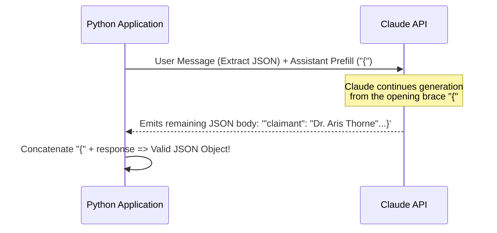

# 03. Hands-on Labs & Code Runbooks

This module provides practical, beginner-friendly code runbooks and step-by-step labs using the **Anthropic Python SDK** (`anthropic`) and the **Claude Messages API**.

---

## 🛠️ Lab 1: Anthropic Python SDK Quickstart

### Prerequisites
```bash
pip install anthropic
export ANTHROPIC_API_KEY="sk-ant-api03-..."
```

### Basic Call Anatomy
```python
import anthropic

client = anthropic.Anthropic()

response = client.messages.create(
    model="claude-3-5-sonnet-20241022",
    max_tokens=1024,
    temperature=0.0,
    system="You are an enterprise cloud security architect.",
    messages=[
        {"role": "user", "content": "What are the core pillars of AWS Well-Architected Framework?"}
    ]
)

print(response.content[0].text)
```

```text
+---------------------+      +-------------------------------+      +----------------------+
|  Python Client App  | ---> |  Anthropic Messages API       | ---> |  Response Payload    |
|  (anthropic.create) |      |  model: "claude-3-5-sonnet"   |      |  text block in list  |
+---------------------+      +-------------------------------+      +----------------------+
```

---

## 🏷️ Lab 2: Canonical XML Prompt Structuring Lab

This pattern demonstrates how to properly feed context, constraints, and tasks to Claude using native XML tags.

```python
import anthropic

client = anthropic.Anthropic()

system_prompt = """
You are a senior compliance officer. Your job is to audit supplier policies against internal compliance rules.
"""

user_prompt = """
<context>
<supplier_policy name="Vendor Alpha Policy">
All employees may work remotely without VPN access if connected to hotel Wi-Fi. Passwords must be at least 6 characters and do not expire.
</supplier_policy>
</context>

<rules>
1. Evaluate the vendor policy against standard zero-trust security principles.
2. Flag all critical security vulnerabilities.
3. If no violations exist, output "COMPLIANT".
4. Format output in strict bullet points with risk severity: [CRITICAL], [HIGH], [MEDIUM], [LOW].
</rules>

<task>
Audit the provided Vendor Alpha Policy and provide your risk breakdown.
</task>
"""

response = client.messages.create(
    model="claude-3-5-sonnet-20241022",
    max_tokens=1024,
    temperature=0.0,
    system=system_prompt,
    messages=[{"role": "user", "content": user_prompt}]
)

print(response.content[0].text)
```

---

## 🔒 Lab 3: Assistant Prefill for Guaranteed JSON Extraction

To completely prevent conversational chit-chat (*"Sure, here is your JSON:"*), prefill the assistant's turn with `{`.

```python
import anthropic
import json

client = anthropic.Anthropic()

system_prompt = "You are a data transformation engine. Output ONLY valid JSON matching the requested schema."

user_message = """
<input_text>
Dr. Aris Thorne submitted an expense report for $1,420.50 on November 1st, 2026 for the Cloud Architecture Summit in Chicago.
</input_text>

<schema>
{
  "claimant": "string",
  "amount": "float",
  "currency": "USD",
  "date": "YYYY-MM-DD",
  "purpose": "string"
}
</schema>

Extract the data strictly according to the schema.
"""

response = client.messages.create(
    model="claude-3-5-haiku-20241022",
    max_tokens=500,
    temperature=0.0,
    system=system_prompt,
    messages=[
        {"role": "user", "content": user_message},
        {"role": "assistant", "content": "{"}  # <--- CRITICAL PREFILL
    ]
)

# Re-attach the opening brace that was prefilled
full_json_str = "{" + response.content[0].text
parsed_data = json.loads(full_json_str)

print("Parsed JSON cleanly:")
print(json.dumps(parsed_data, indent=2))
```



---

## ⚡ Lab 4: Implementing Anthropic Prompt Caching

To cache large static reference documents, pass `cache_control: {"type": "ephemeral"}` in the content block.

```python
import anthropic

client = anthropic.Anthropic()

# Large static reference document (must exceed 1024 tokens for Sonnet)
with open("massive_regulatory_guideline.txt", "r", encoding="utf-8") as f:
    heavy_guidelines = f.read()

response = client.messages.create(
    model="claude-3-5-sonnet-20241022",
    max_tokens=1000,
    system=[
        {
            "type": "text",
            "text": "You are a regulatory compliance auditor.",
        },
        {
            "type": "text",
            "text": heavy_guidelines,
            "cache_control": {"type": "ephemeral"}  # <--- MARKS CACHE BREAKPOINT
        }
    ],
    messages=[
        {"role": "user", "content": "Does section 4 allow external subcontractors?"}
    ]
)

# Inspect token usage metrics:
usage = response.usage
print(f"Base Input Tokens: {usage.input_tokens}")
print(f"Cache Creation Tokens (1.25x billed): {usage.cache_creation_input_tokens}")
print(f"Cache Read Tokens (0.10x billed): {usage.cache_read_input_tokens}")
```

---

## 📋 Lab 5: Claude Projects Configuration Checklist

When configuring a **Claude Project** for an enterprise team:
1. **Name & Objective**: Give a clear scope (e.g., `FinTech Compliance Review Hub`).
2. **Custom Instructions**:
   - Define output tone (professional, authoritative, concise).
   - Set grounding directives: *"Cite specific file names and page numbers from Project Knowledge."*
   - Define fallback behavior: *"If information is missing, explicitly note that it is absent."*
3. **Project Knowledge Files**:
   - Upload key reference policies, API specs, or PRDs (up to 200,000 tokens total).
   - Avoid duplicate or conflicting documents.
