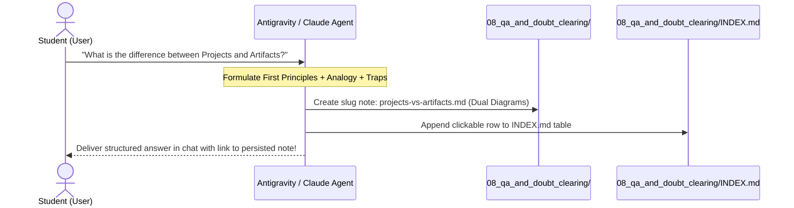

# Anthropic Claude Certified Associate — Foundations (CCAO-F) Study Hub

> **Target Goal**: Pass the official **Claude Certified Associate - Foundations (CCAO-F)** exam with **Distinction (>850/1000)** within a 30-day timeline while building production-grade enterprise expertise.

This repository is an **autonomous, self-documenting certification engine** equipped with custom agent skills, strict architectural directives, hands-on lab runbooks, and an auto-cataloging doubt-clearing system.

---

## 🧭 Repository Navigation & Learning Modules

| Module Directory | Primary Focus | Status |
| :--- | :--- | :---: |
| [📁 `00_roadmap_and_study_plan/`](./00_roadmap_and_study_plan/README.md) | 30-Day Master Schedule, 4-Phase Milestones, Daily Checklist | Ready 🟢 |
| [📁 `01_core_concepts_and_fundamentals/`](./01_core_concepts_and_fundamentals/README.md) | Claude Model Family, Prompt Anatomy, XML Tags, Hyperparameters | Ready 🟢 |
| [📁 `02_architecture_and_deep_dives/`](./02_architecture_and_deep_dives/README.md) | Prompt Caching Architecture, Claude Projects, RAG Trade-offs | Ready 🟢 |
| [📁 `03_hands_on_labs_and_code/`](./03_hands_on_labs_and_code/README.md) | Python SDK Quickstart, XML Lab, JSON Prefill, Caching Code | Ready 🟢 |
| [📁 `04_observability_security_and_ops/`](./04_observability_security_and_ops/README.md) | Constitutional AI, Enterprise Data Privacy, Prompt Injection Defense | Ready 🟢 |
| [📁 `05_scenario_questions_and_drills/`](./05_scenario_questions_and_drills/README.md) | High-Yield Pearson VUE Scenarios, Full Distractor Explanations | Ready 🟢 |
| [📁 `08_qa_and_doubt_clearing/`](./08_qa_and_doubt_clearing/INDEX.md) | **Auto-Persisting Knowledge Base**: Automatically catalogs every doubt | Active ⚡ |

---

## 📊 Exam Blueprint & Syllabus Mapping (CCAO-F)

The Claude Certified Associate - Foundations exam consists of **60 scenario-based questions** over **120 minutes**, scored on a scale of 100 to 1,000 (Passing: **720**, Target: **900+**).

| Domain # | Domain Title | Weight | Core Competencies Tested | Module Link |
| :---: | :--- | :---: | :--- | :---: |
| **1** | **Prompting and Task Execution** | **24%** | System prompts, XML tags (`<context>`, `<rules>`), few-shot canonical examples, assistant response prefilling, chain-of-thought scratchpads (`<thinking>`). | [Module 01](./01_core_concepts_and_fundamentals/README.md) |
| **2** | **Output Evaluation and Validation** | **14%** | Factual grounding against documents, citation verification, JSON schema compliance, graceful fallbacks for missing context. | [Module 01](./01_core_concepts_and_fundamentals/README.md) / [03](./03_hands_on_labs_and_code/README.md) |
| **3** | **Product and Model Selection** | **16%** | Selecting between Haiku (low-latency, cheap), Sonnet (coding, vision, balanced), and Opus (deep research); choosing between Chat, Projects, Artifacts, and Messages API. | [Module 01](./01_core_concepts_and_fundamentals/README.md) / [02](./02_architecture_and_deep_dives/README.md) |
| **4** | **Workflow Integration and Solution Design** | **14%** | Human-in-the-loop review loops, pipeline chaining, multi-step document summarization, multimodal image analysis. | [Module 02](./02_architecture_and_deep_dives/README.md) / [04](./04_observability_security_and_ops/README.md) |
| **5** | **Configuration and Knowledge Management** | **12%** | Claude Projects setup, 200k project knowledge base, custom project instructions, Anthropic Prompt Caching (1024/2048 token thresholds, 5-min TTL). | [Module 02](./02_architecture_and_deep_dives/README.md) / [03](./03_hands_on_labs_and_code/README.md) |
| **6** | **Governance, Risk, and Responsible Use** | **10%** | Constitutional AI (Helpful, Honest, Harmless), commercial zero-data-training guarantee, direct and indirect prompt injection mitigation. | [Module 04](./04_observability_security_and_ops/README.md) |
| **7** | **Troubleshooting and Optimization** | **10%** | Diagnosing lazy or truncated outputs (`stop_reason`), tuning temperature & top_p, token budget management. | [Module 04](./04_observability_security_and_ops/README.md) / [05](./05_scenario_questions_and_drills/README.md) |

---

## ⚡ High-Yield Quick-Reference Cheat Sheet

### 1. Model Selection Matrix
| Model Tier | Best For | Typical Latency | Cost (Input / Output per MTok) |
| :--- | :--- | :--- | :--- |
| **Claude 3.5 Haiku** | High-throughput classification, triage, routing, chatbots | < 1 second | ~$0.80 / $4.00 |
| **Claude 3.5 Sonnet** | Full-stack coding, vision, complex multi-step agents | Moderate | ~$3.00 / $15.00 |
| **Claude 3 Opus** | Deep philosophical, mathematical, or academic synthesis | Higher | ~$15.00 / $75.00 |

### 2. Prompt Caching Golden Rules
- **Cache Hit Savings**: **90% discount** on cached input tokens (`0.10x` base cost); Cache write is `1.25x` base cost.
- **TTL Mechanism**: 5-minute sliding window (resets on every cache hit).
- **Minimum Thresholds**:
  - Claude 3.5 Sonnet & Claude 3 Opus: **1,024 tokens**.
  - Claude 3.5 Haiku: **2,048 tokens**.
- **Prefix Rule**: Static content (system instructions, documents) must be placed at the beginning; dynamic content at the end.

### 3. XML Tag Hierarchy Standard
```xml
<system_instructions> You are an enterprise risk analyst. </system_instructions>
<context> <document id="doc_1"> Raw reference data here </document> </context>
<rules> 1. Use only provided facts. 2. If unknown, state 'UNKNOWN'. </rules>
<task> Extract risk level and remediation. </task>
```

---

## 🔄 Autonomous Q&A Persistence Engine

When studying with this repository, the agent automatically executes the following persistence workflow:

```text
User Question / Doubt
         |
         v
+--------------------------------------------------------------+
| AI Agent checks First Principles, Analogy & CCAO-F Traps    |
+--------------------------------------------------------------+
         |
         +---------------------------------------+
         |                                       |
         v                                       v
[08_qa_and_doubt_clearing/<slug>.md]   [08_qa_and_doubt_clearing/INDEX.md]
(Detailed Tutorial & Dual Diagrams)    (Updated with clickable link & summary)
```



---

## 💾 Version Control & Git Backup Runbook

To maintain and synchronize your certification notes with GitHub / GitLab:

```bash
# 1. Initialize git repository (if not already initialized)
git init

# 2. Add all structured study files
git add .

# 3. Commit your learning milestones
git commit -m "feat: bootstrap Claude Certified Associate Foundations study hub"

# 4. Link your remote repository and push
git branch -M main
git remote add origin https://github.com/<your-username>/anthropic-claude-certifications.git
git push -u origin main
```

---

## 🚀 How to Begin Your Study Journey

1. Open [`00_roadmap_and_study_plan/README.md`](./00_roadmap_and_study_plan/README.md) to review your **Day 1 to Day 30 milestones**.
2. Proceed to [`01_core_concepts_and_fundamentals/README.md`](./01_core_concepts_and_fundamentals/README.md) for **Domain 1 & Domain 3 deep-dives**.
3. Ask your AI mentor any doubt at any time—every explanation will be automatically captured into [`08_qa_and_doubt_clearing/`](./08_qa_and_doubt_clearing/INDEX.md).
