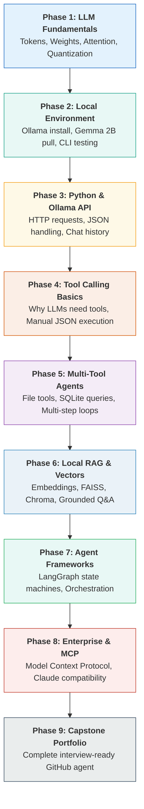

# 00. Beginner Roadmap, Hardware Sizing & Zero-Cost Setup

Welcome to the start of your journey! Before writing any code, we will set up your local development environment and demystify how your hardware runs AI models locally.

---

## 🗺️ The 9-Phase Hands-On Progression

```text
PHASE 1: Foundations   PHASE 2: Local Setup    PHASE 3: Python API     PHASE 4: Tool Calling
(Tokens, Weights,      (Install Ollama,        (Functions, Lists,      (Word counter,
 Attention, Context)    Pull Gemma 2B)          JSON, Chat History)     Manual JSON tool loop)
         |                       |                       |                       |
         +-----------------------+-----------------------+-----------------------+
                                     |
                                     v
PHASE 5: Multi-Tool     PHASE 6: Local RAG      PHASE 7: Frameworks     PHASE 8 & 9: Real Projects
(SQL, File Readers,     (Embeddings, FAISS/     (LangGraph,             (Autonomous Assistant,
 Multi-step workflows)   Chroma vector DBs)      State & Checkpoints)    MCP, GitHub Portfolio)
```



---

## 💻 Hardware Sizing: Choosing the Right Model for Your Machine

AI models consume system **RAM** (and GPU **VRAM** if you have a graphics card). We use **quantized models** (`q4_K_M`), which compress the model weights into 4-bit numbers so they run smoothly even on standard laptops without dedicated GPUs!

| Your Available RAM | Recommended Model | Model Size on Disk | RAM Usage | Best Used For |
| :---: | :---: | :---: | :---: | :--- |
| **8 GB RAM** | `gemma2:2b` or `qwen2.5:3b` | ~1.6 GB – 2.0 GB | ~2.5 GB RAM | Fast, lightweight, great for learning Python & tool calling. |
| **16 GB RAM** | `gemma2:2b` or `qwen2.5:7b` | ~1.6 GB – 4.7 GB | ~5.5 GB RAM | Balanced speed and reasoning; runs smoothly on CPU. |
| **32 GB+ RAM** | `gemma2:9b` or `qwen2.5:14b` | ~5.5 GB – 9.0 GB | ~11.0 GB RAM | Deep reasoning, complex tool orchestration, multi-turn RAG. |

> [!NOTE]
> Even if your machine has **no dedicated Nvidia GPU**, Ollama will automatically use your CPU threads and multi-channel system RAM to run models with great speed!

---

## 🖥️ Cross-Platform Terminal Quick Reference

Keep this table handy whether you are using Windows or macOS:

| Action | Windows PowerShell | macOS Terminal |
| :--- | :--- | :--- |
| **Print current folder** | `pwd` | `pwd` |
| **List files and folders** | `dir` or `ls` | `ls -la` |
| **Create new folder** | `mkdir my_project` | `mkdir my_project` |
| **Change directory** | `cd my_project` | `cd my_project` |
| **Check Python version** | `python --version` | `python3 --version` |
| **Create virtual environment** | `python -m venv .venv` | `python3 -m venv .venv` |
| **Activate virtual environment**| `.\.venv\Scripts\Activate.ps1` | `source .venv/bin/activate` |
| **Install Python packages** | `python -m pip install requests` | `python3 -m pip install requests` |
| **Check Ollama status** | `ollama --version` | `ollama --version` |
| **Run Python script** | `python script.py` | `python3 script.py` (or `python script.py` inside venv) |

---

## 🚀 Step-by-Step Installation Guide (Zero Cost)

> [!TIP]
> A complete visual walkthrough with dual diagrams and troubleshooting is available in [Q&A 003: Step-by-Step Guide to Installing Ollama & Models](../08_qa_and_doubt_clearing/003-downloading-installing-ollama-and-models.md).

### Step 1: Install Python (If not already installed)
- **Windows**: Download from [python.org](https://www.python.org/downloads/). **CRITICAL**: Check the box that says *"Add Python to PATH"* during installation!
- **macOS**: Install via Homebrew: `brew install python` (or download the official macOS installer from python.org).
- Verify in your terminal: `python --version` (or `python3 --version`).

### Step 2: Install Ollama (Your Local AI Engine)
Ollama is a free, single-click installer that runs open-weight models locally:
- **Option A (Web Browser)**:
  - Visit **[https://ollama.com/download](https://ollama.com/download)**.
  - **Windows**: Download and run `OllamaSetup.exe`.
  - **macOS**: Download `Ollama-darwin.zip` and drag `Ollama.app` into Applications.
- **Option B (Windows PowerShell via Winget)**:
  ```powershell
  winget install Ollama.Ollama
  ```
- **Option C (macOS via Homebrew)**:
  ```bash
  brew install ollama
  ```

> [!IMPORTANT]
> **Restart Terminal After Installing**: If your terminal or VS Code was open while Ollama was installing, **close and reopen your terminal** so it recognizes the newly updated system PATH!

### Step 3: Verify Ollama in Your Terminal
Open a new terminal window and verify:
```bash
ollama --version
```
*Expected Output:* `ollama version is 0.5.x` (or newer).

Next, verify that Ollama's local background web server is active:
- Open your browser to: **`http://localhost:11434`**
- You should see the confirmation: **`Ollama is running`**

### Step 4: Download & Test Your First Model (`gemma2:2b`)
In your terminal, run:
```bash
ollama run gemma2:2b
```
- Ollama will download ~1.6 GB of 4-bit quantized weights from the Google Gemma family.
- Once downloaded, it will start an interactive terminal chat: `>>> Send a message (/? for help)`.
- Type: `Hello, who are you?`
- Gemma will reply instantly from your own computer!
- Type `/bye` to exit back to your command line.

```text
+---------------------------------------------------------------+
| PS C:\Users\user> ollama run gemma2:2b                        |
| pulling manifest ... done                                     |
| pulling 4b21a3642337... 100% 1.6 GB                           |
| verifying sha256 digest ... done                              |
| success                                                       |
| >>> Hello, who are you?                                       |
| I am Gemma, a lightweight model developed by Google...        |
| >>> /bye                                                      |
+---------------------------------------------------------------+
```

### Step 5: Essential Model Management Commands

| Action | Command | What It Does |
| :--- | :--- | :--- |
| **List installed models** | `ollama list` | Shows all models downloaded on your hard drive and their size. |
| **Check running models** | `ollama ps` | Shows which model is currently loaded into your RAM. |
| **Download without chatting** | `ollama pull gemma2:2b` | Downloads model weights in the background. |
| **Download higher-reasoning model** | `ollama pull gemma2:9b` | Downloads the larger 9B model (if you have 16 GB+ RAM). |
| **Delete a model** | `ollama rm gemma2:2b` | Deletes the model to free up hard drive space. |

### Where Models Live on Disk:
- **Windows**: `C:\Users\<YourUsername>\.ollama\models`
- **macOS**: `~/.ollama/models`

---

## 🏆 Setup Milestone Checklist

Before moving to Phase 1, ensure:
- [ ] Python is installed (`python --version` returns 3.10 or higher).
- [ ] VS Code is installed with the official Microsoft Python extension.
- [ ] Ollama is installed (`ollama --version` returns a valid version).
- [ ] You have run `ollama run gemma2:2b` and chatted with it in the terminal.
- [ ] Visiting `http://localhost:11434` displays *"Ollama is running"*.

