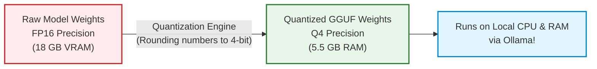
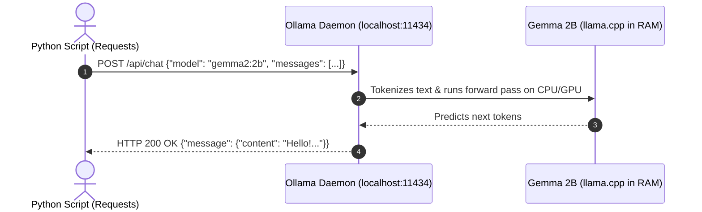

# 01. LLM Fundamentals & Local Ollama Architecture

Before writing Python code to build agents, we need to understand what happens inside your machine when an LLM runs and how Ollama exposes a local REST API.

---

## 1. Parameters & Quantization: How Big AI Fits on a Laptop

### Concept & Analogy:
An AI model consists of billions of mathematical numbers called **Parameters** (or weights).
- **Parameters are like the volume knobs on a giant sound mixing board**: During training, Google turned 2 billion knobs (`2B`) or 9 billion knobs (`9B`) to the exact micro-notch so the model reproduces human thought.
- Normally, each knob is stored as a high-precision 16-bit decimal (`FP16`). This requires huge amounts of RAM ($2 \text{ bytes} \times 9 \text{ billion} \approx 18 \text{ GB of VRAM}$).
- **Quantization is the Digital MP3 Compression of AI**: 
  Instead of recording every sound wave at lossless studio quality, an MP3 rounds off minor frequencies that humans barely hear, reducing file size by 75%. 
  **Quantization (e.g., `Q4_K_M`)** compresses 16-bit numbers into 4-bit numbers. The model loses less than 1% of its reasoning quality, but its RAM footprint drops from **18 GB down to 5 GB**, allowing it to run smoothly on everyday personal computers!

```text
FULL PRECISION (FP16):           QUANTIZED 4-BIT (Q4_K_M):
[ Knob = 0.81749201582 ]         [ Knob = 0.82 ]
Huge File Size | Needs $2,000 GPU  Tiny File Size | Runs on Any Laptop
```



---

## 2. How Ollama Works Under the Hood

### Concept:
When you install Ollama, it does two distinct things:
1. **The Core Engine (`llama.cpp`)**: A blazingly fast C++ engine that loads the model weights into your computer's RAM/CPU and runs matrix math.
2. **The Local Web Server (`localhost:11434`)**: A background server that listens for standard HTTP requests from your Python programs, exactly like a mini cloud server running right on your desk.

```text
+-----------------------+      HTTP POST /api/chat     +-------------------------+
|  YOUR PYTHON PROGRAM  | ---------------------------> |   OLLAMA BACKGROUND     |
|  (my_script.py)       | <--------------------------- |   SERVER (:11434)       |
+-----------------------+        JSON Response         +-------------------------+
                                                                    |
                                                              Loads weights into RAM
                                                                    v
                                                       +-------------------------+
                                                       |   GEMMA 2 NEURAL NET    |
                                                       |   (Tokens & Probability)|
                                                       +-------------------------+
```



---

## 3. The Two Key Ollama Endpoints: `/api/generate` vs. `/api/chat`

Ollama offers two primary HTTP interfaces:

| Endpoint | Purpose | Analogy | Structure |
| :--- | :--- | :--- | :--- |
| **`POST /api/generate`** | Single prompt completion | Auto-completing a sentence | Takes a single `"prompt": "Once upon a time..."` string. |
| **`POST /api/chat`** | Multi-turn structured conversation | A WhatsApp text chat thread | Takes a list of `"messages": [{"role": "user", "content": "Hi"}]`. |

> [!IMPORTANT]
> **For Building Agents, Always Use `/api/chat`!**
> `/api/chat` supports roles (`"system"`, `"user"`, and `"assistant"`), which allows you to establish the agent's persona and maintain short-term memory across turns.

---

## 4. Python Fundamentals: Dictionaries, Lists & JSON

Before making our first call, let's understand the three Python data structures that drive every AI program:

### 1. What is a Python Dictionary? (`dict`)
A dictionary stores data in **Key-Value pairs** inside curly braces `{}`. Think of a phonebook: name $\to$ phone number.
```python
# A simple Python dictionary:
user_profile = {
    "name": "Alex",
    "role": "Student",
    "experience_years": 0
}

# Accessing a value by its key:
print(user_profile["name"])  # Outputs: Alex
```

### 2. What is a Python List? (`list`)
A list is an ordered collection of items inside square brackets `[]`.
```python
# A list of messages:
chat_history = [
    {"role": "system", "content": "You are a helpful coding tutor."},
    {"role": "user", "content": "What is Python?"}
]

# Accessing the first item (Python uses 0-based indexing):
print(chat_history[0]["role"])  # Outputs: system
```

### 3. What is JSON?
**JSON (JavaScript Object Notation)** is the international language of web APIs.
- In Python, a dictionary lives in memory as a Python object.
- When sending it over the network to Ollama, we convert it into a formatted text string using `json.dumps()` (serializing).
- When Ollama sends back a text string, we parse it back into a Python dictionary using `json.loads()` or `response.json()` (deserializing).

```text
PYTHON DICTIONARY (In Memory)                JSON STRING (Over Network)
{"role": "user", "content": "Hi"}   <====>   '{"role": "user", "content": "Hi"}'
```

---

## 5. Controlling Creativity: Temperature, Top-P, and Top-K

When Ollama runs Gemma, it uses three hyper-parameters:
1. **Temperature ($0.0 - 1.0$)**: The randomness dial. Set to `0.0` for coding, math, and tool calling; set to `0.7` for creative writing.
2. **Top-K**: Tells the model: *"Only consider the top K most likely words"* (e.g., top 40 words).
3. **Top-P (Nucleus Sampling)**: Tells the model: *"Keep picking words until their cumulative probability hits P"* (e.g., 0.9 = 90%).

---

## 💼 Interview Perspective

1. **Question: What is quantization in LLMs, and why is it essential for edge/local deployments?**
   - *Answer:* Quantization reduces the numerical precision of weights (e.g., from 16-bit floating point to 4-bit integers). This shrinks the model's memory footprint by up to 75% with negligible degradation in reasoning quality, allowing models like Gemma and Llama to run on commodity CPUs and edge devices without expensive high-VRAM enterprise GPUs.
2. **Question: How does the Ollama `/api/chat` endpoint differ from `/api/generate`?**
   - *Answer:* `/api/generate` expects a single unstructured prompt string and returns text completion. `/api/chat` accepts an array of structured message objects with assigned roles (`system`, `user`, `assistant`), enabling multi-turn conversation memory, persona grounding, and structured agent loops.

---

## 🎯 Knowledge Checkpoint

1. What does the `B` stand for in `gemma2:2b`? (Hint: Knobs on a mixing board).
2. What port and hostname does Ollama listen to by default on your computer?
3. Which endpoint should you use to build an AI agent that remembers conversation history?

