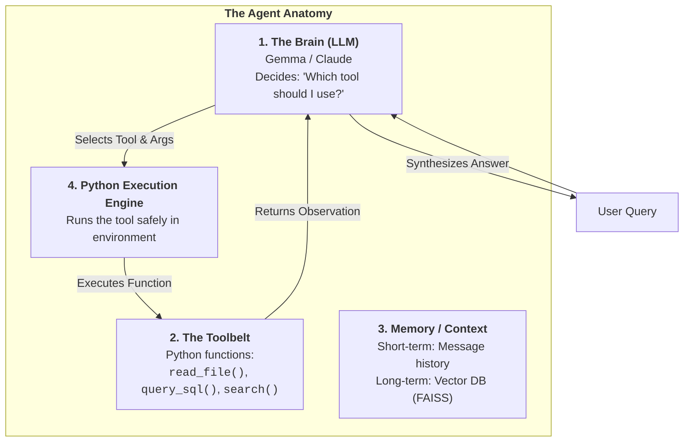
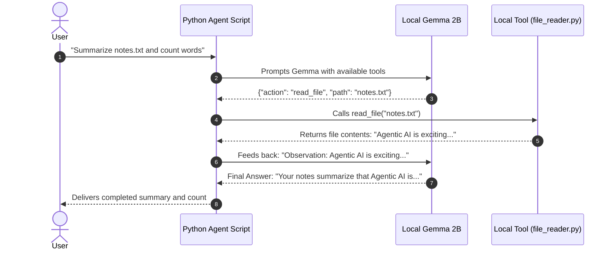
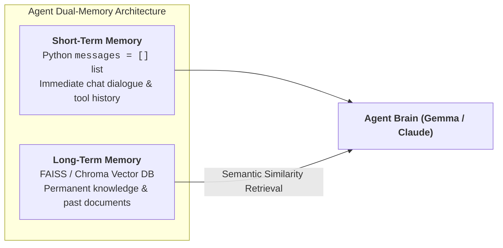

# 02. Architecture Deep Dives: How AI Agents Think & Call Tools

The single biggest conceptual breakthrough in modern AI is understanding the difference between a **raw LLM** and an **autonomous AI Agent**.

In this module, we dissect the anatomy of an agent, the **Agent Loop (ReAct pattern)**, and how tools turn a simple text predictor into an active problem solver.

---

## 1. Raw LLM vs. AI Agent: The "Brain in a Jar"

### Concept & Analogy:
- **A Raw LLM is a "Brain in a Jar"**: 
  It is extraordinarily brilliant and has read millions of books. But it has no eyes, no hands, no clock, and no internet connection. If you ask it: *"What is the weather outside right now?"* or *"How many characters are in this file?"*, it can only guess or hallucinate. It cannot reach out into the physical or digital world.
- **An AI Agent is that Brain Given Hands, Eyes, and a Toolbelt**:
  An agent consists of the LLM paired with **Python functions (tools)** and an **execution loop**. When you ask the agent: *"What is the weather in Tokyo?"*, the brain says: *"I don't know, but I have a tool called `get_weather`. I will emit a command for Python to run `get_weather(city='Tokyo')`."* Python executes the code, hands the temperature back to the brain, and the brain answers your question with factual truth!

```text
RAW LLM (Brain in a Jar)                      AI AGENT (Brain + Toolbelt + Loop)
+-------------------------------+             +-------------------------------+
| Can only guess from training  |             | Has active Python tools:      |
| No real-time data access      |    VS       | - Weather API                 |
| Cannot run code or read files |             | - SQL database reader         |
| Passive text generator        |             | - Local file system scanner   |
+-------------------------------+             +-------------------------------+
```



---

## 2. The Agent Loop: The ReAct Pattern (Reason $\to$ Act $\to$ Observe)

How does an agent actually solve complex, multi-step tasks? It executes a cycle known as **ReAct (Reasoning + Acting)**:

```text
+-------------------------------------------------------------------------------+
| STEP 1: REASON (Thought)                                                      |
| The LLM looks at the user goal and its available tools.                       |
| "To answer how many words are in data.txt, I first need to read the file."     |
+-------------------------------------------------------------------------------+
                                       |
                                       v
+-------------------------------------------------------------------------------+
| STEP 2: ACT (Action / Tool Call)                                              |
| The LLM generates a structured JSON request:                                  |
| {"tool": "read_file", "arguments": {"filepath": "data.txt"}}                  |
+-------------------------------------------------------------------------------+
                                       |
                                       v
+-------------------------------------------------------------------------------+
| STEP 3: OBSERVE (Observation)                                                 |
| Python executes read_file("data.txt") and feeds the raw text back to the LLM. |
+-------------------------------------------------------------------------------+
                                       |
                                       v
+-------------------------------------------------------------------------------+
| STEP 4: REPEAT OR CONCLUDE                                                    |
| The LLM sees the observation: "The file contains 42 words."                   |
| Final Answer: "The file data.txt contains exactly 42 words."                  |
+-------------------------------------------------------------------------------+
```



---

## 3. How Tool Calling Works (Under the Hood)

Beginners often imagine that the LLM magically runs computer code inside its own neural network. **It does not!**

### The 4 Step Separation of Powers:
1. **The LLM is pure language**: It merely outputs text.
2. **We teach it a JSON Schema**: We tell Gemma: *"If you want to use a tool, output valid JSON with the format: `{"tool_name": "...", "arguments": {...}}`"*.
3. **Python is the Execution Hand**: Python intercepts the JSON, checks if the tool exists, calls the Python function, and catches any errors.
4. **The Observation Loop**: Python appends the tool's output to the conversation history as a message and prompts the model again.

> [!CAUTION]
> **Rule of Agent Security**:
> Never use `eval()` to run code from an LLM. Always map tool names to explicit, pre-defined Python functions (e.g., `if tool_name == "count_words": count_words(text)`).

---

## 4. Short-Term Memory vs. Long-Term Vector Memory

An agent needs memory to maintain context:

```text
SHORT-TERM MEMORY (Chat History)             LONG-TERM MEMORY (Vector DB / RAG)
+------------------------------------+       +------------------------------------+
| A Python list of message dicts:    |       | FAISS / Chroma database on disk:   |
| [                                  |       | - High-dimensional vector index    |
|   {"role": "user", "content": ...},|       | - Searchable across 100,000 files  |
|   {"role": "assistant", ...}       |       | - Semantically retrieves only what |
| ]                                  |       |   the agent needs right now        |
| Kept inside active Context Window  |       | Scalable, permanent, persistent    |
+------------------------------------+       +------------------------------------+
```



---

## 5. Bridging Local Agents to Claude & MCP (Model Context Protocol)

Everything you learn here preparing local tool loops directly translates to Anthropic's enterprise ecosystem:

1. **Anthropic Tool Use**: In the Claude API, tools are declared in a `tools=[...]` array. Claude responds with a `tool_use` block, and your backend executes it.
2. **Model Context Protocol (MCP)**: An open standard created by Anthropic allowing agents to plug into local databases, Git repositories, Slack, and file systems through a standardized client-server interface.
3. Once you understand how Python handles tool calls locally, mastering Claude's tool calling and MCP will feel second nature!

---

## 💼 Interview Perspective

1. **Question: What is the fundamental difference between an LLM application and an Agent?**
   - *Answer:* An LLM application follows a fixed, pre-programmed execution flow (e.g., take user prompt $\to$ query database $\to$ summarize result). An Agent has autonomous decision-making capability: it analyzes the state, dynamically determines whether to call a tool, inspects the tool's output, and decides the next action or final response iteratively.
2. **Question: What is the purpose of the ReAct (Reason + Act) loop?**
   - *Answer:* ReAct combines reasoning ("thoughts") with action ("tool execution"). It prevents hallucination by grounding the model in real-world observations, allowing it to dynamically handle unexpected intermediate results and correct errors before delivering a final answer.

