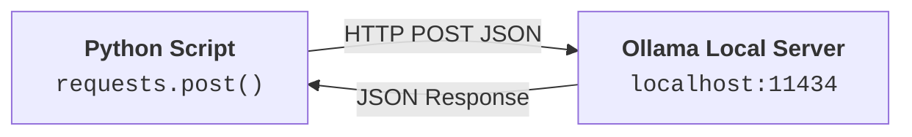
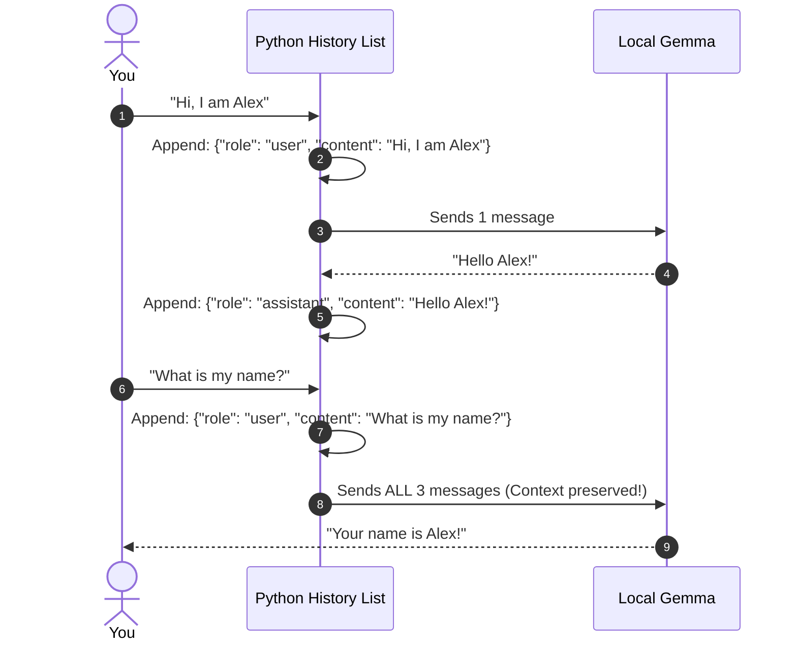
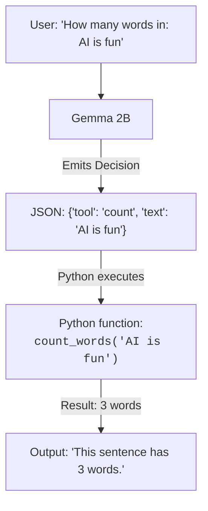

# 03. Hands-On Labs: Building Local Agents from Scratch

In this module, you will manually write and run **5 bite-sized Python programs (10–15 lines each)**. Every Python function, variable, and concept is explained in plain English before you write it.

---

## 🧪 Lab 1: Your First Local API Call (Python `requests`)

### 1. Concept:
We will write a 10-line Python script that sends a question to Ollama on your local computer (`http://localhost:11434`) and prints the response.

### 2. Why Do We Need It?
Before building agents, we must know how Python talks to Ollama without any third-party AI frameworks.

### 3. Architecture:
```text
[ Python Script (test_call.py) ] ---> HTTP POST :11434/api/generate ---> [ Ollama Gemma 2B ]
```



### 4. Python Fundamentals:
- `import requests`: Imports a popular Python library for sending web requests over the internet or localhost.
- `url = "..."`: A variable holding the web address of your local Ollama server.
- `payload = {...}`: A dictionary holding the request data (which model to use, the prompt, and `"stream": False` to get the whole answer at once).
- `response.json()`: Converts the raw text received from Ollama into a Python dictionary.

### 5. Hands-On Code:
Create a file named `01_first_call.py` and manually type:

```python
import requests

# 1. Ollama's local URL
url = "http://localhost:11434/api/generate"

# 2. What we want to send
payload = {
    "model": "gemma2:2b",
    "prompt": "Explain what a computer is in one short sentence.",
    "stream": False
}

# 3. Send the request and print the answer
response = requests.post(url, json=payload)
data = response.json()
print("Gemma says:", data["response"])
```

### 6. Cross-Platform Instructions:
Install `requests` first if not installed:
- **Windows PowerShell**: `python -m pip install requests`
- **macOS Terminal**: `python3 -m pip install requests`

Run the script:
- **Windows**: `python 01_first_call.py`
- **macOS**: `python3 01_first_call.py`

### 7. Expected Output:
```text
Gemma says: A computer is an electronic device that processes information and performs calculations based on instructions.
```

### 8. Technical Explanation:
`requests.post()` automatically took the Python dictionary `payload`, serialized it into a JSON string, sent an HTTP POST request to Ollama's background service on port 11434, waited for Gemma to predict the answer, and converted the JSON reply back into a Python dictionary where `data["response"]` contains the text.

---

## 🧪 Lab 2: Chat Endpoints & `json.dumps()`

### 1. Concept:
Instead of a raw text prompt, we switch to `/api/chat` using structured roles (`"user"` and `"assistant"`). We explicitly use Python's built-in `json` module to see how JSON serialization works.

### 2. Why Do We Need It?
Agents require conversation structure (`role`) so they know who said what.

### 3. Architecture:
```text
[ Python dict ] ---> json.dumps() ---> [ Raw JSON String ] ---> [ Ollama /api/chat ]
```

```mermaid
flowchart LR
    Dict["Python Dict:<br/><code>{'role': 'user'}</code>"] -->|"json.dumps()"| JSONStr["Raw JSON String:<br/><code>'{\"role\": \"user\"}'</code>"]
    JSONStr -->|"HTTP POST"| OllamaChat["<b>Ollama /api/chat</b>"]
```

### 4. Python Fundamentals:
- `import json`: Python's built-in module for working with JSON.
- `json.dumps(obj)`: Takes a Python dictionary or list and turns it into a formatted text string ("dump string").
- `headers = {"Content-Type": "application/json"}`: Tells the server we are sending JSON data.

### 5. Hands-On Code:
Create `02_json_chat.py` and type:

```python
import requests
import json

url = "http://localhost:11434/api/chat"

# We structure our message with a role!
messages = [
    {"role": "system", "content": "You are a concise AI tutor. Never use more than 15 words."},
    {"role": "user", "content": "What is Python?"}
]

# Send the request
response = requests.post(
    url, 
    data=json.dumps({"model": "gemma2:2b", "messages": messages, "stream": False}),
    headers={"Content-Type": "application/json"}
)

result = response.json()
print("Tutor:", result["message"]["content"])
```

### 6. Run & Expected Output:
- **Run**: `python 02_json_chat.py`
- **Output**:
  ```text
  Tutor: Python is a versatile, beginner-friendly programming language used for web, data, and AI.
  ```

---

## 🧪 Lab 3: Conversation Memory (Saving Context in Python)

### 1. Concept:
Ollama itself is completely **stateless**—it does not remember past questions. If you want Gemma to remember what you said 2 minutes ago, **your Python script must save the context** in a list and send the entire conversation history back on every turn!

### 2. Why Do We Need It?
An agent cannot execute multi-step tasks if it forgets what happened on step 1.

### 3. Architecture:
```text
Turn 1: [ User: "My name is Sam" ] ---------------------> Gemma: "Nice to meet you, Sam!"
Turn 2: [ User: "Sam", Gemma: "...", User: "What's my name?" ] -> Gemma: "Your name is Sam!"
```



### 4. Python Fundamentals:
- `history = []`: Creates an empty list to store conversation history.
- `history.append(new_item)`: Adds a new item to the end of the list.
- `while True:`: Creates an interactive loop so you can keep chatting until you type `"quit"`.

### 5. Hands-On Code:
Create `03_chat_memory.py` and type:

```python
import requests

url = "http://localhost:11434/api/chat"
history = []  # Our agent's short-term memory!

print("Chatbot started! Type 'quit' to exit.\n" + "-"*40)

while True:
    user_input = input("You: ")
    if user_input.lower() == "quit":
        break

    # 1. Save user message to memory
    history.append({"role": "user", "content": user_input})

    # 2. Send complete history to Gemma
    response = requests.post(url, json={"model": "gemma2:2b", "messages": history, "stream": False})
    bot_reply = response.json()["message"]["content"]
    
    print(f"Gemma: {bot_reply}\n")

    # 3. Save Gemma's reply to memory so it remembers next time!
    history.append({"role": "assistant", "content": bot_reply})
```

### 6. Experiment:
Run `python 03_chat_memory.py`:
1. Type: `My favorite fruit is Mango.`
2. Type: `What is my favorite fruit?`
3. Notice that Gemma answers: *"Your favorite fruit is Mango!"* because Python preserved the history!

---

## 🧪 Lab 4: Your First Tool-Calling Agent

### 1. Concept:
LLMs cannot count letters accurately. We give Gemma a **Python tool** (`count_words_and_chars`) and tell it to ask for the tool if it needs to count.

### 2. Why Do We Need It?
This is the birth of an **Agent**: the LLM decides to take an action, and Python executes it!

### 3. Architecture:
```text
User asks to count words ---> Gemma emits JSON {"tool": "count", "text": "..."} ---> Python runs function ---> Returns true count!
```



### 4. Hands-On Code:
Create `04_simple_tool_agent.py` and type:

```python
import requests
import json

# The Python Tool that does the real work!
def count_words(text):
    words = text.split()
    return f"The text contains {len(words)} words and {len(text)} characters."

prompt = """
You are an agent with access to ONE tool:
{"tool": "count_words", "text": "<text to analyze>"}

If the user asks you to count words in a sentence, output ONLY the tool JSON above.
User request: Count words in 'Anthropic Claude and Gemma are awesome'
"""

# Ask Gemma to choose
res = requests.post("http://localhost:11434/api/generate", json={"model": "gemma2:2b", "prompt": prompt, "stream": False})
reply = res.json()["response"].strip()
print("Gemma chose action:\n", reply)

# Python executes the chosen tool safely!
if "count_words" in reply:
    text_to_count = "Anthropic Claude and Gemma are awesome"
    tool_result = count_words(text_to_count)
    print("\n[Tool Execution Result]:", tool_result)
```

### 5. Run & Expected Output:
```text
Gemma chose action:
{"tool": "count_words", "text": "Anthropic Claude and Gemma are awesome"}

[Tool Execution Result]: The text contains 6 words and 39 characters.
```

---

## 🧪 Lab 5: Semantic Vectors with Ollama (`/api/embeddings`)

### 1. Concept:
Now let's see how Vector search works! We will ask Ollama to turn two sentences into mathematical vectors and compare them.

### 2. Hands-On Code:
Create `05_simple_vector.py` and type:

```python
import requests
import math

def get_embedding(text):
    res = requests.post("http://localhost:11434/api/embeddings", json={"model": "gemma2:2b", "prompt": text})
    return res.json()["embedding"]

# Calculate cosine similarity (angle between two vectors)
def cosine_similarity(v1, v2):
    dot = sum(a * b for a, b in zip(v1, v2))
    norm_a = math.sqrt(sum(a * a for a in v1))
    norm_b = math.sqrt(sum(b * b for b in v2))
    return dot / (norm_a * norm_b)

print("Calculating semantic vectors...")
vec_puppy = get_embedding("A playful puppy playing in grass")
vec_dog = get_embedding("A small domestic dog outdoors")
vec_airplane = get_embedding("A Boeing 747 airplane flying at high altitude")

print(f"Similarity (Puppy vs Dog):      {cosine_similarity(vec_puppy, vec_dog):.4f}")
print(f"Similarity (Puppy vs Airplane): {cosine_similarity(vec_puppy, vec_airplane):.4f}")
```

### 3. Run & Expected Output:
```text
Calculating semantic vectors...
Similarity (Puppy vs Dog):      0.8924
Similarity (Puppy vs Airplane): 0.3121
```
*Look at that!* Even though the words "puppy" and "dog" are spelled differently, their vector similarity is **~0.89 (89%)**, while the airplane is only **0.31**. This is the mathematical foundation of all Vector Databases and RAG!

---

## 💼 Interview Perspective

1. **Question: Why is conversation history managed client-side in REST APIs rather than server-side?**
   - *Answer:* Keeping the LLM server stateless allows it to scale horizontally without keeping millions of user sessions in GPU memory. The client application is responsible for appending turns and sending the relevant context window on each request.
2. **Question: How does an agent ensure safety when calling external tools?**
   - *Answer:* Never evaluate raw model output using arbitrary code execution like `eval()`. Instead, force the model to emit structured JSON matching a predefined schema, validate parameters in application code, and invoke whitelisted functions.

