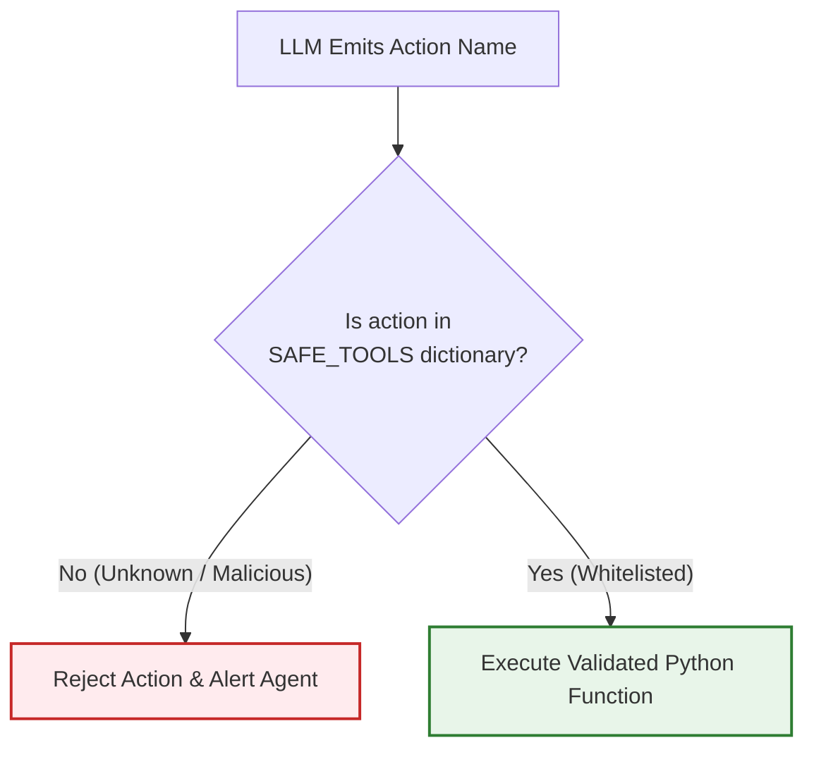
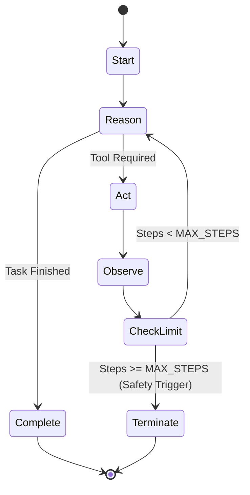

# 04. Agent Observability, Security & Local Operations

Building an agent that works in a toy demo is easy; building an agent that doesn't crash your server, get stuck in infinite loops, or execute malicious code is what separates hobbyists from professional AI engineers.

In this module, we examine **secure tool execution, agent loop limits, and local hardware performance tuning**.

---

## 1. The Cardinal Rule: Never Use `eval()` or `exec()`

### First Principles & Danger:
When an LLM outputs code or commands, beginners are often tempted to use Python's built-in `eval()` or `exec()`:
```python
# ❌ CATASTROPHIC SECURITY VULNERABILITY:
model_output = "__import__('os').system('rmdir /s /q C:\\')"
eval(model_output)  # Wipes your computer!
```
If an attacker tricks the model via prompt injection, or if the model hallucinates a dangerous command, `eval()` executes it with full operating system permissions!

### The Secure Solution: Whitelisted Dispatcher
Always map string names to explicit, hardcoded Python functions using a dictionary:

```python
# ✅ SECURE PRODUCTION PATTERN:
SAFE_TOOLS = {
    "count_words": count_words_func,
    "get_weather": get_weather_func,
    "search_db": search_db_func
}

def execute_tool_safely(tool_name, arguments):
    if tool_name not in SAFE_TOOLS:
        return f"Error: Tool '{tool_name}' is not authorized."
    
    # Safely call the whitelisted function
    return SAFE_TOOLS[tool_name](**arguments)
```

```text
DANGEROUS:  LLM String ---> eval() ---> Arbitrary OS Execution (Hacker Risk!)
SAFE:       LLM String ---> Whitelist Dict Check ---> Known Safe Function
```



---

## 2. Preventing Infinite Agent Loops (`MAX_ITERATIONS`)

### The Infinite Loop Trap:
What happens if an agent runs a tool, gets an unexpected error, decides to retry, gets the same error, and loops forever?
- Your CPU usage spikes to 100%.
- Your local RAM fills up.
- In cloud systems, an unconstrained loop can cost thousands of dollars in minutes!

### The Circuit Breaker Pattern:
Always enforce a strict `max_steps` or `max_iterations` counter in your agent while loop:

```python
MAX_STEPS = 5
current_step = 0

while current_step < MAX_STEPS:
    current_step += 1
    # Run agent step...
    if task_completed:
        break
else:
    print("Circuit breaker triggered: Agent exceeded maximum 5 steps.")
```



---

## 3. Context Window Pruning: The Sliding Window Memory

If a user chats with your local agent for 45 minutes, the `messages = [...]` list might reach 30,000 tokens. 
Eventually, it will exceed Gemma's 8,000-token context window and Ollama will throw an error or truncate text.

### The Sliding Window Strategy:
Keep the `system` prompt fixed at index 0, and retain only the last $N$ turns:

```python
def prune_conversation(messages, max_history=6):
    if len(messages) <= max_history:
        return messages
    
    # Keep the system prompt (first message) and the last (max_history - 1) messages
    system_prompt = messages[0]
    recent_messages = messages[-(max_history - 1):]
    return [system_prompt] + recent_messages
```

---

## 4. Hardware Optimization for Local LLMs

When running models on a laptop without a dedicated Nvidia GPU:

1. **Thread Tuning**: Tell Ollama how many CPU cores to use via `num_thread` in parameters.
2. **Context Size Limitation**: Limit `num_ctx` to 2048 or 4096 tokens to conserve RAM.
3. **Model Offloading**: If you have an Apple Silicon Mac (M1/M2/M3) or Windows laptop with integrated Intel Iris Xe / AMD Radeon, Ollama automatically shares unified memory!

---

## 💼 Interview Perspective

1. **Question: How do you prevent arbitrary code execution vulnerabilities in LLM agents?**
   - *Answer:* By disallowing dynamic interpreters like `eval()` and strictly implementing a tool-dispatching registry. The model only has permission to output the name of a registered tool and JSON arguments, which are validated against schema boundaries before calling pre-compiled local functions.
2. **Question: What is an agent circuit breaker?**
   - *Answer:* A circuit breaker sets hard constraints (e.g., maximum iterations, maximum elapsed time, or max token budget) on the agent execution loop. It guarantees that an agent trapped in a repetitive reasoning or error loop terminates safely without exhausting system resources.

