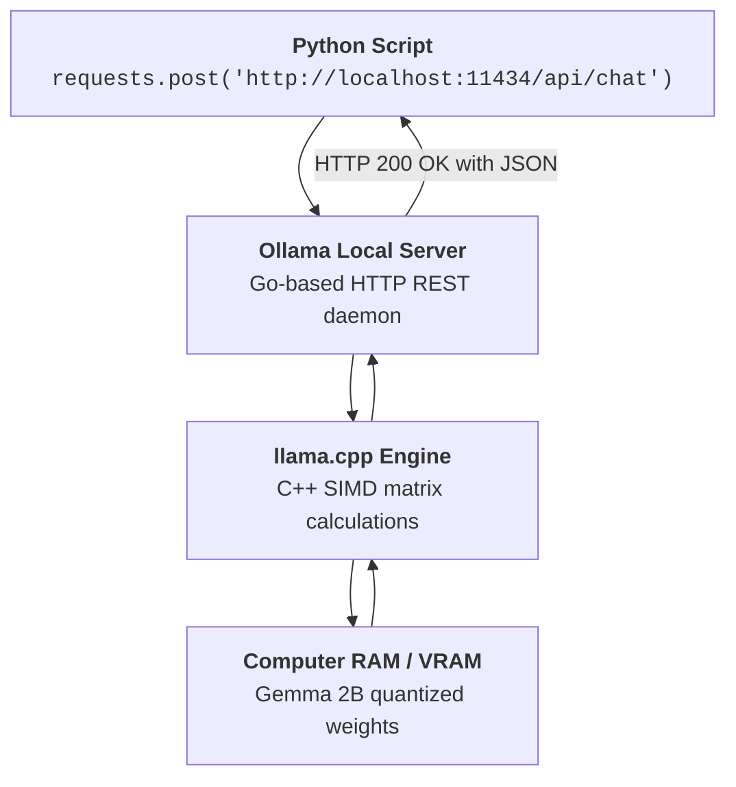

# Q&A 001: How the Ollama Local API Works Under the Hood

**Date Added:** 2026-11-02  
**Target Domain:** Local Inference, Ollama Architecture & REST Endpoints  
**Core Takeaway:** Ollama runs a lightweight background HTTP server on port 11434 powered by `llama.cpp`. Your Python code communicates with it via standard HTTP POST requests with JSON payloads—completely free and offline.

---

## 1. First Principles: What Problem Does Ollama Solve?

Before Ollama was created, running an open-source LLM like Gemma or Llama on a laptop required:
- Installing gigabytes of complex C++ compilers.
- Manually compiling `llama.cpp` or PyTorch with custom GPU flags.
- Converting raw model checkpoints into GGUF format manually.
- Writing your own socket or HTTP server to accept prompt requests.

**Ollama solved this by packaging everything into a clean, zero-configuration executable.**

---

## 2. Real-World Analogy: The Local Micro-Bakery

Think of Ollama as a self-contained, automated bakery sitting in your kitchen:
- **The Raw Model Weights (`gemma2:2b`)**: The raw flour, sugar, and yeast recipes sitting in a sealed pantry.
- **The Engine (`llama.cpp`)**: The high-efficiency oven that bakes bread in seconds.
- **The Front Counter (`localhost:11434`)**: The order window.
  - You (the Python program) walk up to the counter and slip an order ticket under the glass: `POST /api/generate {"prompt": "Bake a croissant"}`.
  - The baker processes the recipe in memory and hands you the fresh croissant (the JSON response).
- You never have to leave your house (no internet connection required), and you never have to pay a delivery fee (zero API costs!).

```text
+-----------------------+      HTTP POST /api/chat     +-------------------------+
|  YOUR PYTHON PROGRAM  | ---------------------------> |    OLLAMA SERVER        |
|  (my_script.py)       | <--------------------------- |    (Port :11434)        |
+-----------------------+        JSON Response         +-------------------------+
                                                                    |
                                                                RAM Access
                                                                    v
                                                       +-------------------------+
                                                       |   GEMMA MODEL WEIGHTS   |
                                                       |   (Quantized Q4_K_M)    |
                                                       +-------------------------+
```



---

## 3. The Two Core Endpoints Breakdown

### 1. `/api/generate` (Single Shot Completion)
```json
// POST http://localhost:11434/api/generate
{
  "model": "gemma2:2b",
  "prompt": "Why is the sky blue?",
  "stream": false
}
```
- **Returns:**
```json
{
  "model": "gemma2:2b",
  "response": "The sky is blue because of Rayleigh scattering...",
  "done": true
}
```

### 2. `/api/chat` (Multi-Turn Structured Conversations)
```json
// POST http://localhost:11434/api/chat
{
  "model": "gemma2:2b",
  "messages": [
    {"role": "system", "content": "You are a math tutor."},
    {"role": "user", "content": "What is 12 * 12?"}
  ],
  "stream": false
}
```
- **Returns:**
```json
{
  "model": "gemma2:2b",
  "message": {
    "role": "assistant",
    "content": "12 * 12 is 144."
  },
  "done": true
}
```

---

## 4. Why `"stream": false` is Crucial for Beginners

By default, Ollama streams responses character-by-character (like a typewriter on screen). 
When you are learning Python, streaming requires handling chunked HTTP readers and generator functions. 
By setting `"stream": false`, Ollama waits until the complete answer is generated and delivers it as **one single, clean JSON object** that you can read with a simple `data["message"]["content"]`!

