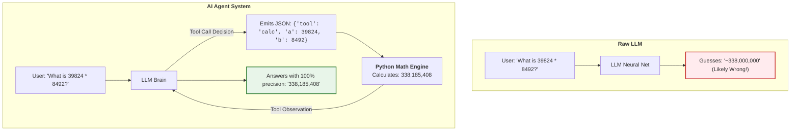

# Q&A 002: What is an AI Agent vs. a Raw LLM?

**Date Added:** 2026-11-02  
**Target Domain:** Agent Architecture, Tool Calling & Autonomous Workflows  
**Core Takeaway:** A raw LLM is a passive next-token text generator. An AI Agent is an active computational system where the LLM's decisions are connected to an execution loop and real-world tools (Python functions, databases, APIs).

---

## 1. First Principles: The Limitations of Pure Prediction

A raw LLM like Gemma or Claude is trained to predict the next most likely token.
- It can write an eloquent 500-word essay on the history of Rome.
- But if you ask it: *"What is the current price of Bitcoin?"* or *"Look at this 2 GB file on my C: drive and tell me how many errors are logged"*, it fails.
- Why? Because **it has no perception of the present moment and cannot interact with the external environment**.

An **Agent** solves this by pairing the predictive brain with a runtime environment (Python).

---

## 2. Real-World Analogy: The Scholar in the Tower vs. The Field Detective

### The Raw LLM is the Scholar in the Isolated Tower:
Imagine a scholar locked in an ancient stone tower:
- They have memorized every textbook in existence up to the year 2023.
- If you slip a philosophical riddle under the door, they will slide back a breathtaking, brilliant answer.
- But if you ask: *"Is it raining outside right now?"*, the scholar has to look at the ceiling, guess based on seasonal probabilities, and say: *"It is likely cloudy with a chance of rain."* They cannot see the sky!

### The AI Agent is the Field Detective:
Now imagine that scholar equipped with a walkie-talkie and an eager junior detective stationed outside:
- When you ask: *"Is it raining?"*, the detective in the tower speaks into the radio: *"Junior, look out the window and report back"* (Tool Call).
- The junior detective looks outside and replies: *"It is pouring rain with heavy wind"* (Observation).
- The scholar synthesizes the observation and answers: *"Yes, it is currently pouring rain with strong winds."*

```text
RAW LLM:       User Query ---------------------> Model Guesses / Hallucinates
AI AGENT:      User Query ---> Model Chooses Tool ---> Python Runs Tool ---> Model Answers Accurately
```



---

## 3. How Does This Connect to Anthropic Claude Agents?

Whether you are running a local 2-billion parameter Gemma model on your laptop or Claude 3.5 Sonnet on Anthropic's cloud infrastructure, the **Agent Architecture is identical**:

1. **Tool Declaration**: You provide a list of available tools with descriptions and required arguments.
2. **Model Selection**: The model evaluates the user's intent and outputs a structured request to call a tool.
3. **Host Execution**: Your code (local Python or your cloud backend) executes the function.
4. **Observation Feedback**: The function's result is passed back into the conversation thread.
5. **Final Output or Next Step**: The model either uses the observation to answer the user or decides to call another tool!

Once you master this loop locally, you can switch the backend URL from `http://localhost:11434` to `https://api.anthropic.com` with virtually zero mental friction.

