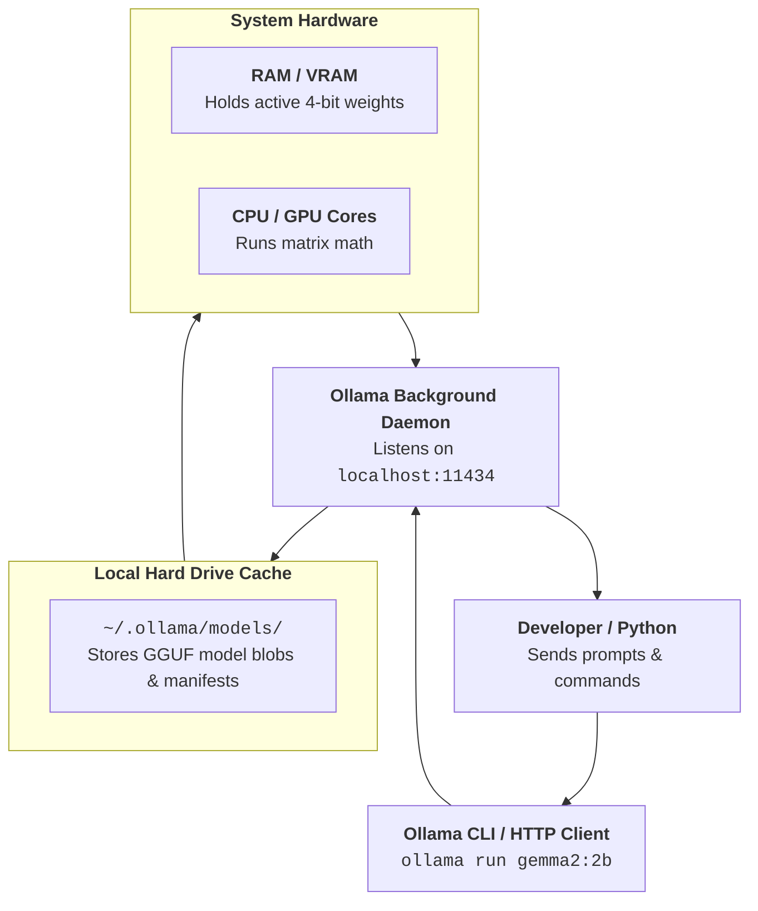

# Q&A 003: Step-by-Step Guide to Installing Ollama & Pulling Local Models (Gemma 2)

**Date Added:** 2026-11-02  
**Target Domain:** Local Inference, Tooling Setup & Model Management  
**Core Takeaway:** Ollama installs as a background service listening on `localhost:11434`. Pulling a model like `gemma2:2b` downloads ~1.6 GB of quantized weights into your user profile and allows complete offline execution.

---

## 1. First Principles: What Does Ollama Actually Install?

When you install Ollama on your computer, it sets up three components:
1. **The CLI (`ollama.exe`)**: A command-line program added to your system PATH so you can type `ollama run` from any terminal.
2. **The Background Service (Daemon)**: A lightweight program running quietly in your Windows system tray / macOS menu bar that hosts the HTTP server at `http://localhost:11434`.
3. **The Model Cache (`~/.ollama/models`)**: A dedicated folder on your hard drive where all downloaded model weights and manifest files are stored.

```text
+-------------------------------------------------------------------------------+
|                             YOUR LOCAL COMPUTER                               |
|                                                                               |
|   Terminal (PowerShell / Bash)  --->  ollama.exe CLI                          |
|                                            |                                  |
|                                            v                                  |
|   Background Service (Daemon)   --->  http://localhost:11434                  |
|                                            |                                  |
|                                            v (Loads weights into RAM)         |
|   Model Storage Directory       --->  C:\Users\<you>\.ollama\models\          |
|                                       (~/.ollama/models on macOS)             |
+-------------------------------------------------------------------------------+
```



---

## 2. Real-World Analogy: The Standalone Kitchen Blender

Installing Ollama is like buying a high-speed countertop blender:
- **Cloud AI (ChatGPT / Claude web)** is like ordering a fruit smoothie from a food delivery app. You pay per cup, you must wait for delivery, and you have to share your address and preferences over the internet.
- **Ollama** is the blender sitting permanently on your kitchen counter.
- **The Model (`gemma2:2b`)** is a bag of frozen fruit you buy once and put in your freezer.
- Once the blender is on your counter and the fruit is in your freezer, you can make 50 smoothies a day:
  - It costs \$0.00.
  - It works even if your home Wi-Fi is completely down.
  - Nobody on the internet can see what recipe you are blending!

---

## 3. Step-by-Step Installation Runbook

### Step 1: Downloading the Official Installer

1. Open your web browser and navigate to: **[https://ollama.com/download](https://ollama.com/download)**.
2. Select your Operating System:
   - **For Windows**: Click **"Download for Windows"** (Downloads `OllamaSetup.exe`, ~60 MB).
   - **For macOS**: Click **"Download for Mac"** (Downloads `Ollama-darwin.zip`).

> [!TIP]
> **PowerShell Alternative (Automated via Winget on Windows)**:
> If you prefer the command line, you can install Ollama via Windows Package Manager:
> ```powershell
> winget install Ollama.Ollama
> ```

---

### Step 2: Running the Installation

#### On Windows:
1. Double-click the downloaded `OllamaSetup.exe`.
2. Click **"Install"**. The installer will copy the files into `C:\Users\<YourUser>\AppData\Local\Programs\Ollama`.
3. Once completed, a small llama icon 🦙 will appear in your Windows **System Tray** (bottom-right corner next to your clock).
4. **Restart your Terminal**: If you had PowerShell or VS Code open during installation, **close it and open a fresh terminal** so it recognizes the newly updated system PATH!

#### On macOS:
1. Unzip `Ollama-darwin.zip`.
2. Drag `Ollama.app` into your **Applications** folder.
3. Open `Ollama.app`. When macOS asks if you want to install command line tools, click **"Install"**.

---

### Step 3: Verifying the Installation

Open your terminal and check the version:

| Windows PowerShell | macOS Terminal | Expected Output |
| :--- | :--- | :--- |
| `ollama --version` | `ollama --version` | `ollama version is 0.5.x` |

Next, verify that the local web server is running:
- Open your browser to: **`http://localhost:11434`**
- You should see the plain text: **`Ollama is running`**

```text
+-----------------------------------------------------------+
|  Chrome / Edge: http://localhost:11434                    |
|                                                           |
|  Ollama is running                                        |
+-----------------------------------------------------------+
```

---

### Step 4: Downloading and Running Google Gemma 2

Ollama downloads models using the `ollama pull` or `ollama run` command:

```bash
ollama run gemma2:2b
```

#### What Happens When You Run This:
1. Ollama connects to the official Ollama model registry.
2. It downloads the 4-bit quantized GGUF weights (~1.6 GB).
3. A progress bar will show the download percentage:
   ```text
   pulling manifest ... done
   pulling 4b21a3642337... 100% ▕████████████████████████▏ 1.6 GB
   verifying sha256 digest ... done
   writing manifest ... done
   success
   ```
4. Once completed, it presents an interactive prompt:
   ```text
   >>> Send a message (/? for help)
   ```

#### Test It:
Type: `Why is the sky blue? Explain in 10 words.`  
Gemma will generate an answer right in your terminal.

#### How to Exit:
Type:
```text
>>> /bye
```
*(Or press `Ctrl + D` on Mac/Linux or `Ctrl + C` on Windows).*

---

## 4. Essential Ollama Commands Cheat Sheet

Here are the 5 commands you will use 99% of the time:

```text
+-------------------------------+-------------------------------------------------------+
| COMMAND                       | WHAT IT DOES                                          |
+-------------------------------+-------------------------------------------------------+
| ollama run <model>            | Downloads model (if missing) and starts a chat session|
| ollama pull <model>           | Downloads the model in background without starting chat|
| ollama list                   | Shows all models currently downloaded on your machine |
| ollama rm <model>             | Deletes a model from your hard drive to free disk space|
| ollama ps                     | Shows which models are currently loaded in RAM/VRAM   |
+-------------------------------+-------------------------------------------------------+
```

### Examples:
```bash
# 1. See what models you have downloaded on disk:
ollama list

# 2. Check which model is currently running in RAM:
ollama ps

# 3. Download the larger 9B model (if you have 16 GB+ RAM):
ollama pull gemma2:9b

# 4. Remove a model you don't need anymore:
ollama rm gemma2:2b
```

---

## 5. Where Are Models Stored on Your Hard Drive?

If you ever want to check how much disk space your models are taking up:

- **Windows**: `C:\Users\<YourUsername>\.ollama\models`
- **macOS**: `~/.ollama/models`
- **Linux**: `/usr/share/ollama/.ollama/models`

> [!TIP]
> **Changing Model Storage Location (Windows)**:
> If your `C:` drive is running out of space and you want to store models on `D:`, you can set an environment variable:
> 1. Set `OLLAMA_MODELS = D:\ollama_models`.
> 2. Restart the Ollama system tray application.

---

## 6. Troubleshooting Common Beginner Pitfalls

### Trap 1: `'ollama' is not recognized as an internal or external command`
- **Cause**: Your terminal was already open before Ollama finished installing, so it doesn't know about the new PATH.
- **Fix**: Completely close your PowerShell or VS Code terminal and launch a fresh new terminal window.

### Trap 2: `Error: could not connect to ollama app, is it running?`
- **Cause**: The background daemon was stopped or didn't start at login.
- **Fix**:
  - **Windows**: Search for "Ollama" in the Windows Start Menu and launch it.
  - Or manually run in any terminal: `ollama serve`.

### Trap 3: `failed to allocate memory / Out of Memory (OOM)`
- **Cause**: You tried pulling a model that is too big for your machine (e.g., trying to run `llama3:70b` on an 8 GB laptop).
- **Fix**: Stick to models tailored to your RAM:
  - 8 GB RAM $\to$ `gemma2:2b` or `qwen2.5:3b`
  - 16 GB RAM $\to$ `gemma2:2b` or `qwen2.5:7b`
  - 32 GB RAM $\to$ `gemma2:9b` or `qwen2.5:14b`

