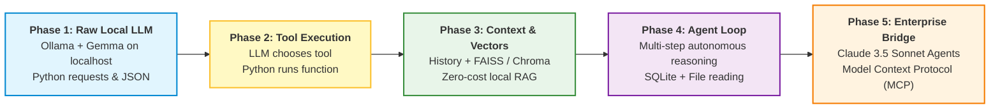

# 🤖 Local Agentic AI: Hands-On Zero-Cost Mentorship with Ollama & Gemma

Welcome to your **Personal Hands-On Agentic AI Learning Journey**! 

This course is designed for **absolute beginners in both Python and Artificial Intelligence**. You will learn how LLMs actually work under the hood, how to run free private AI models completely on your own machine using **Ollama** and **Google Gemma**, how to write clean Python scripts from scratch, and how to build increasingly capable **autonomous AI Agents**—with **zero subscription fees and zero paid API keys**.

Crucially, every local concept you master here directly bridges to enterprise systems like **Anthropic Claude Agents** and the **Model Context Protocol (MCP)**!

---

## 🧭 The Core Learning Philosophy

1. **Step-by-Step Progression**: We never skip ahead. Complex architectures are deconstructed into simple 10–15 line Python scripts.
2. **Mental Models & Real-World Analogies**: Every technical concept is paired with an everyday metaphor.
3. **Internal Mechanics First, Frameworks Later**: We write agents manually using raw Python, HTTP requests, and JSON dictionaries before touching any abstractions like LangChain or LangGraph.
4. **Learn Python Along the Way**: Every function, list, dictionary, loop, and library is explained simply before we use it.
5. **Dual Visual Standard**: Every architecture is illustrated with both a clean ASCII diagram and a Mermaid flow diagram.
6. **Cross-Platform**: Every instruction comes with side-by-side commands for **Windows PowerShell** and **macOS Terminal**.

```text
+-----------------------+     +------------------------+     +----------------------+
| 1. RAW PYTHON & HTTP  | --> | 2. TOOL CALLING ENGINE | --> | 3. MEMORY & VECTORS  |
| Send JSON to Ollama   |     | Python executes tools  |     | FAISS / Chroma RAG   |
+-----------------------+     +------------------------+     +----------------------+
                                                                    |
                                                                    v
+-----------------------+     +------------------------+     +----------------------+
| 6. CLAUDE & MCP AGENTS| <-- | 5. AGENT FRAMEWORKS    | <-- | 4. MULTI-TOOL AGENT  |
| Enterprise Production |     | LangGraph Orchestration|     | Autonomous Decision  |
+-----------------------+     +------------------------+     +----------------------+
```



---

## 🛠️ The Zero-Cost Tech Stack

You will never be asked to enter a credit card or pay for API credits:

| Component | Technology | Why We Use It |
| :--- | :--- | :--- |
| **Programming Language** | **Python (3.10+)** | The global standard for AI, readable and beginner-friendly. |
| **Local Model Runner** | **Ollama** | Lightweight, open-source engine that runs LLMs locally on CPU / GPU. |
| **Local LLM** | **Gemma 2 (2B / 9B)** / **Qwen 2.5** | High-performance, open-weights models built by Google DeepMind and Alibaba. |
| **Development IDE** | **VS Code** | Clean, free editor with built-in terminal and Python extensions. |
| **Local Database** | **SQLite** | Built directly into Python—no server installation required. |
| **Local Vector DB** | **FAISS / ChromaDB** | Free, open-source vector similarity search running in your RAM/disk. |
| **Agent Orchestration** | **Manual Python $\to$ LangGraph** | Understand manual loops first, then use orchestration frameworks. |

---

## 🗺️ Master Curriculum Modules

| Directory | Title | Core Hands-On Focus |
| :--- | :--- | :--- |
| [**00_roadmap_and_study_plan/**](./00_roadmap_and_study_plan/README.md) | **Roadmap & Environment Setup** | 9-Phase detailed syllabus, hardware sizing, and cross-platform installation guides (Windows & Mac). |
| [**01_core_concepts_and_fundamentals/**](./01_core_concepts_and_fundamentals/README.md) | **LLM Fundamentals & Ollama Mechanics** | Neural networks, weights, tokens, quantization, and how Ollama runs a REST API on `localhost:11434`. |
| [**02_architecture_and_deep_dives/**](./02_architecture_and_deep_dives/README.md) | **How AI Agents Think & Call Tools** | What makes an "Agent" vs a raw LLM? The Agent Loop, JSON schemas, and manual tool execution. |
| [**03_hands_on_labs_and_code/**](./03_hands_on_labs_and_code/README.md) | **Step-by-Step Hands-On Python Labs** | 5 bite-sized code labs (10–15 lines each): HTTP calls, JSON dumps, conversation memory, and your first tool. |
| [**04_observability_security_and_ops/**](./04_observability_security_and_ops/README.md) | **Agent Safety & Secure Tool Calling** | Why we NEVER use `eval()`, preventing infinite loops, memory bounds, and local performance tuning. |
| [**05_scenario_questions_and_drills/**](./05_scenario_questions_and_drills/README.md) | **Scenario Drills & Interview Prep** | Enterprise scenarios, distractor analysis, and technical interview questions on local LLMs and agents. |
| [**08_qa_and_doubt_clearing/**](./08_qa_and_doubt_clearing/INDEX.md) | **Auto-Persisting Local AI Q&A Hub** | Clear guides for common hurdles (Ollama API JSON structure, Raw LLM vs Agent, Quantization). |

---

## 🌉 Connecting Local Gemma Agents to Claude AI Agents

Everything you build locally with Python and Gemma uses the **exact same foundational mechanics** as Anthropic Claude:

```text
LOCAL OLLAMA + GEMMA AGENT                       ENTERPRISE ANTHROPIC CLAUDE AGENT
+---------------------------------------+        +---------------------------------------+
| Local URL: http://localhost:11434     |        | Cloud URL: https://api.anthropic.com  |
| Request: POST /api/chat               |  <==>  | Request: POST /v1/messages            |
| Body: {"model": "gemma2:2b", ...}     |        | Body: {"model": "claude-3-5-sonnet"}  |
| Tool Execution: Python function run   |        | Tool Execution: Python function run   |
| Standards: Local custom JSON          |        | Standards: Model Context Protocol(MCP)|
+---------------------------------------+        +---------------------------------------+
```

When you understand how Python receives a tool call from Gemma and executes a local function, you will already understand how production enterprise agents work at Anthropic, Google, and OpenAI!

