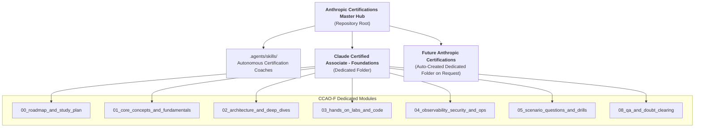

# Anthropic Claude Certifications Master Hub

Welcome to the **Anthropic Claude Certifications Master Study Hub & Command Center**. This workspace hosts comprehensive, self-documenting certification preparation environments, custom agent skills, hands-on lab runbooks, and an autonomous doubt-clearing engine for Anthropic Claude professional credentials.

---

## 🏛️ Active Certification Study Hubs

Each certification is maintained in its own **fully autonomous, dedicated directory** with complete modular curricula, hands-on code labs, scenario practice question banks, and an auto-persisting Q&A knowledge base.

| Certification Track | Dedicated Directory | Level | Status | Passing / Target |
| :--- | :--- | :---: | :---: | :---: |
| **Claude Certified Associate — Foundations (CCAO-F)** | [📂 `Claude Certified Associate - Foundations Certification/`](./Claude%20Certified%20Associate%20-%20Foundations%20Certification/README.md) | Associate | **Active & Ready** 🟢 | **720 / 900+ (Distinction)** |

---

## 🧭 Multi-Certification Workspace Architecture

Every certification track added to this repository follows a strict, self-contained modular numbering system:

```text
c:\Users\sanjoy.halder\Downloads\Anthropic_claude_certifications\
├── .agents/                               # Workspace-wide AI Agent Skills & Tooling
│   └── skills/
│       └── claude-foundations-coach/      # CCAO-F Certification Mentor Skill
│
├── Claude Certified Associate - Foundations Certification/   # Dedicated Certification Folder
│   ├── README.md                          # Master Certification Dashboard & Blueprint Mapping
│   ├── 00_roadmap_and_study_plan/         # 30-Day Daily Schedule & Milestone Checklists
│   ├── 01_core_concepts_and_fundamentals/ # Model Families, System Prompts, XML Tags
│   ├── 02_architecture_and_deep_dives/    # Prompt Caching, Projects vs Artifacts, RAG
│   ├── 03_hands_on_labs_and_code/         # Python Anthropic SDK, Prefilling & Labs
│   ├── 04_observability_security_and_ops/ # Constitutional AI, Data Privacy & Governance
│   ├── 05_scenario_questions_and_drills/  # Pearson VUE Scenario Questions + Distractor Analysis
│   └── 08_qa_and_doubt_clearing/          # Auto-Persisted Doubt Library & INDEX.md
│
├── .gitignore                             # Git configuration (preserves .agents/)
├── AGENTS.md                              # Global Multi-Certification Agent Directives
├── CLAUDE.md                              # Claude-specific assistant instructions
└── README.md                              # Master Certification Portal (This File)
```



---

## ⚡ Master Operating Directives for AI Assistants

All AI assistants operating in this repository adhere to standard protocols:
1. **Dedicated Folder Per Certification**: Whenever the user requests another certification tutorial or track, **always create a new dedicated folder** for it at root (e.g., `Claude Certified Developer - Associate Certification/`) containing its self-contained `00` through `08` structure, and register it here in [README.md](./README.md).
2. **Zero-Effort Persistence**: Any technical question, concept explanation, or architectural doubt is automatically documented in the active certification's `08_qa_and_doubt_clearing/<slug>.md` and indexed in `08_qa_and_doubt_clearing/INDEX.md`.
3. **Universal Dual-Diagrams**: Every concept includes an ASCII box diagram and a Mermaid visual diagram.
4. **4-Step Pedagogy**: First Principles $\to$ Real-World Analogy $\to$ Architecture & Trade-offs $\to$ Exam Trap Warning.

---

## 🚀 Quick Launch

- Open the [Claude Certified Associate - Foundations Study Hub](./Claude%20Certified%20Associate%20-%20Foundations%20Certification/README.md) to explore the 30-day curriculum.
- Review the [30-Day Study Plan](./Claude%20Certified%20Associate%20-%20Foundations%20Certification/00_roadmap_and_study_plan/README.md) to begin Phase 1.
